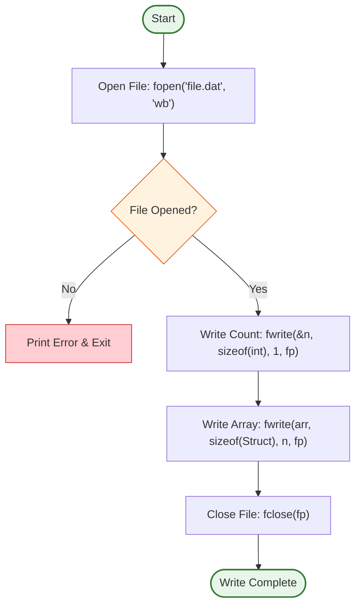
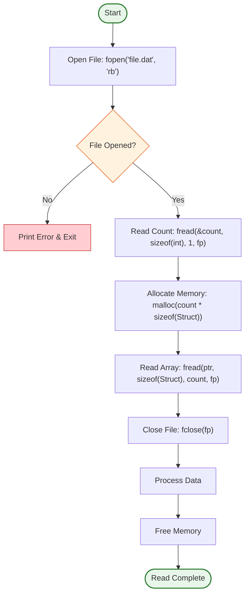
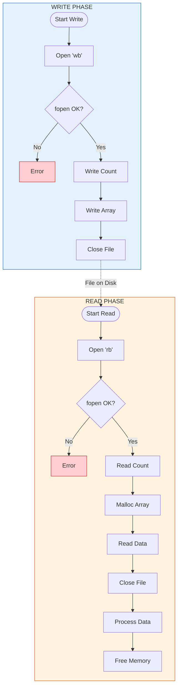
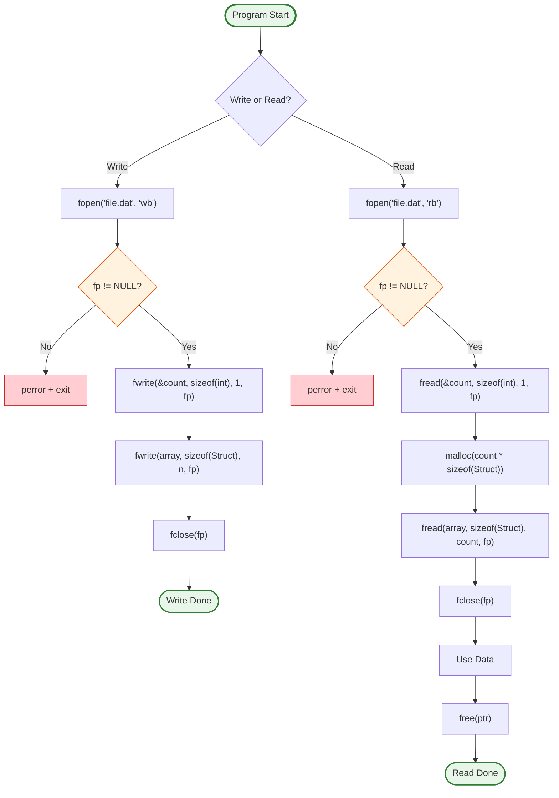
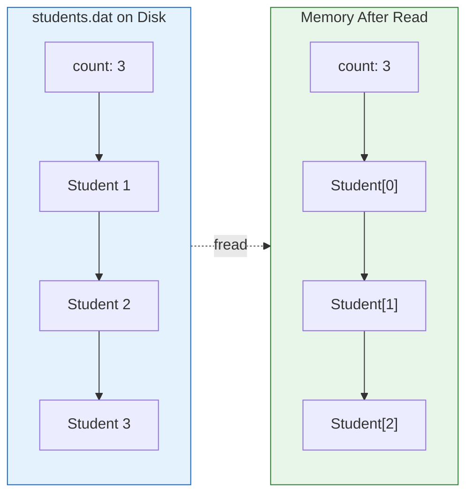

# File I/O Flowchart Explanation

## Binary Write Flowchart

## Binary Read Flowchart

## Combined Write → Read Flowchart

## Detailed Step-by-Step with Decision Points

## Legend

| Symbol | Meaning |
|--------|---------|
| `([ ])` | Start/End (rounded) |
| `[ ]` | Process/Action (rectangle) |
| `{ }` | Decision (diamond) |
| `-->` | Flow direction |
| `.->` | Dotted line (file on disk) |
| `subgraph` | Grouped phase |

## Key Decision Points

| Decision | Check | If No | If Yes |
|----------|-------|-------|--------|
| `fp != NULL` | File opened? | Print error, exit | Continue |
| `fread/fwrite` | Items read/written == expected? | Handle error | Continue |
| `malloc` | Returned NULL? | Handle error | Continue |

## Memory Layout Visualization

