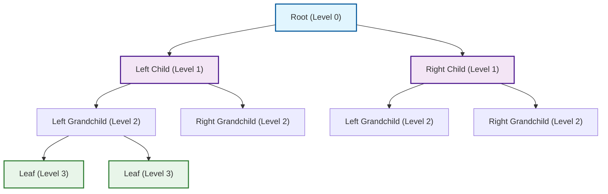
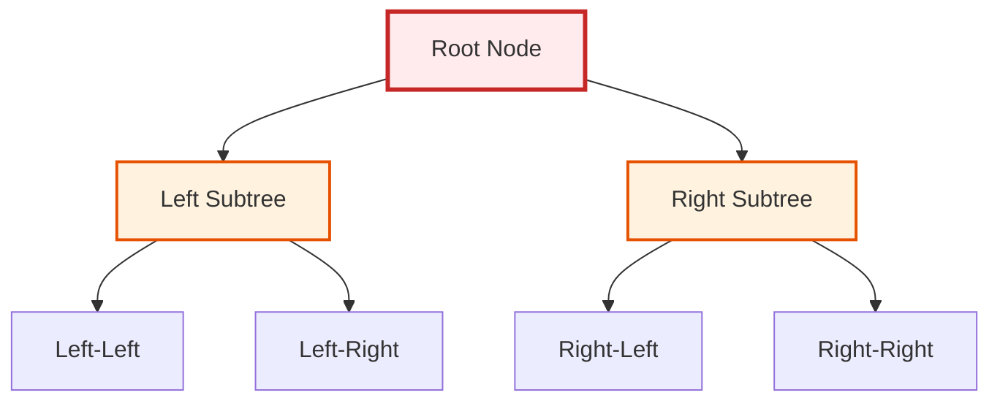

# Unit 3: Trees & Binary Trees

## 🌳 Trees - Fundamental Concepts

### What is a Tree?

> **Tree** = Non-linear, hierarchical data structure
> - **Acyclic**: No cycles
> - **Connected**: Path between any two nodes
> - **n nodes = n-1 edges**

### Tree Terminology (Genealogy + Botany)

| Genealogy Terms | Botany Terms | Structural Terms |
|-----------------|--------------|------------------|
| Parent | Root | Path |
| Child | Node | Level (root=0) |
| Sibling | Leaf | Height (max path to leaf) |
| Ancestor | Branch | Depth (path from root) |
| Descendant | Internal node | Degree (#children) |
| Grandparent | External node | |
| Uncle | | |

### Properties
- Adding edge → creates cycle
- Removing edge → disconnects tree
- Exactly one path between any two nodes

### Tree Visualization


---

## 🌲 Binary Trees

### Definition
> A **binary tree** is a tree where each node has **at most 2 children**, distinguished as **left** and **right**.

**Recursive Definition:**
- Empty tree, OR
- Root + left subtree (binary tree) + right subtree (binary tree)

### Binary Tree Structure


### Node Structure
```c
struct node {
    int key;
    struct node *left;
    struct node *right;
};
typedef struct node node_t;

struct tree {
    node_t *root;
};
typedef struct tree tree_t;
```

---

## 📝 Key Takeaways

| Concept | Key Point |
|---------|-----------|
| **Tree** | Hierarchical, n nodes = n-1 edges |
| **Binary Tree** | Max 2 children per node |
| **Node Structure** | key, left, right pointers |

---

*Next: [Binary Trees & BST →](./unit3_02_binary_trees_bst.md)*