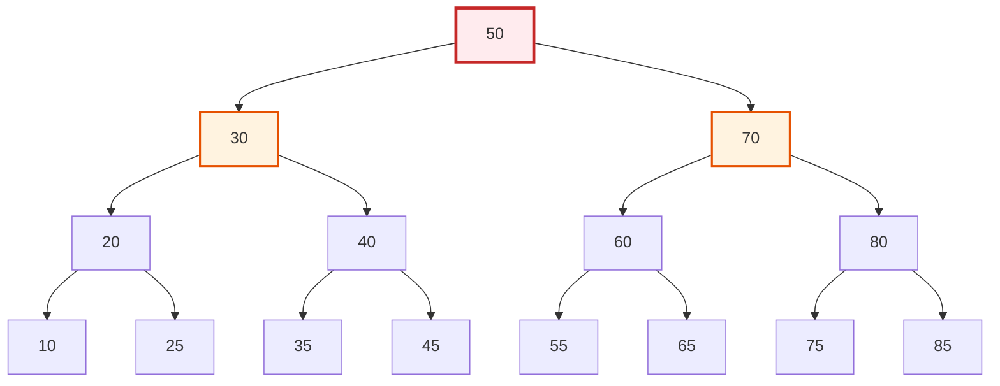
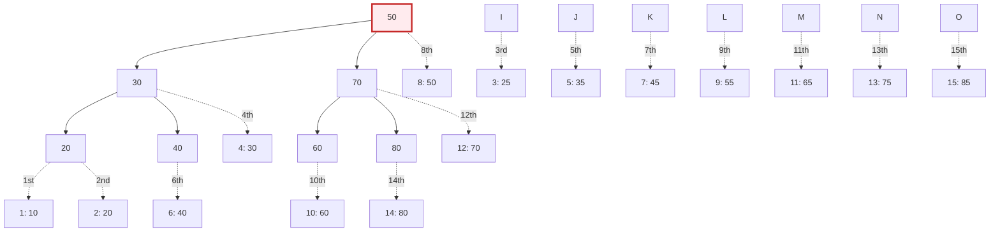
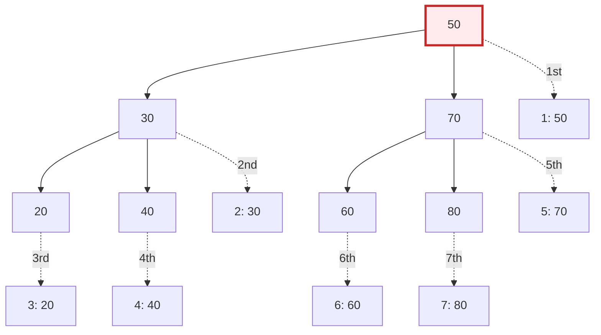
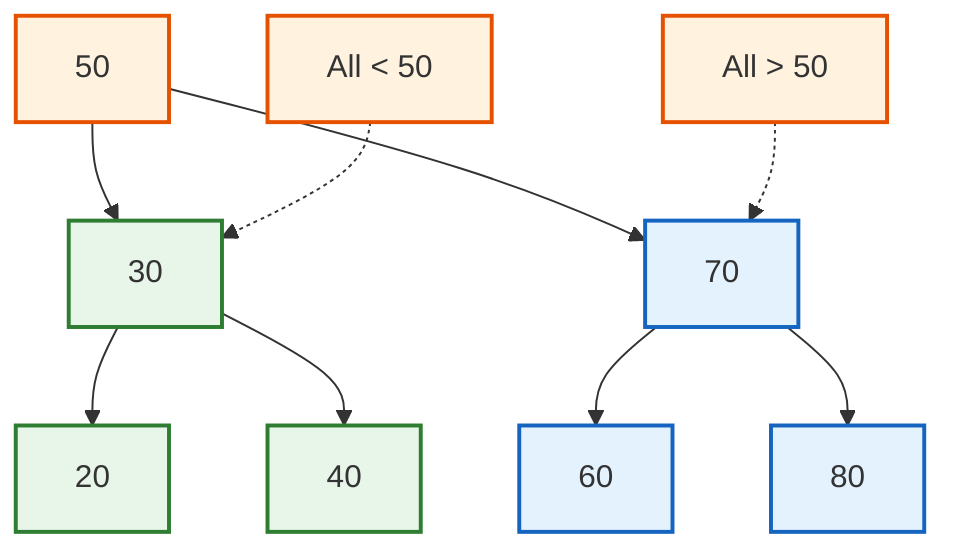
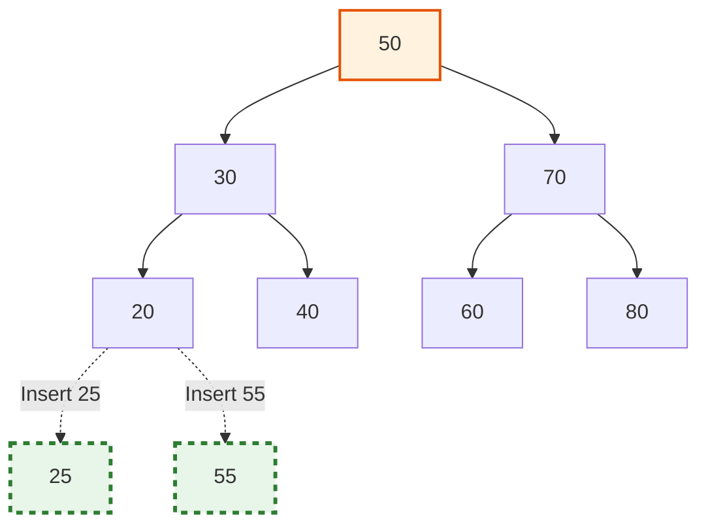

# Unit 3: Binary Trees & BST

## 🌲 Binary Trees

### Definition
> A **binary tree** is a tree where each node has **at most 2 children**, distinguished as **left** and **right**.

**Recursive Definition:**
- Empty tree, OR
- Root + left subtree (binary tree) + right subtree (binary tree)

### Node Structure
```c
struct node {
    int key;
    struct node *left;
    struct node *right;
};
typedef struct node node_t;

struct tree {
    node_t *root;
};
typedef struct tree tree_t;
```

### Binary Tree Visualization


---

## 🔄 Tree Traversals - The Three Orders

### 1. Inorder (Left → Root → Right)
```c
void inorder(node_t *root) {
    if (root) {
        inorder(root->left);
        printf("%d ", root->key);
        inorder(root->right);
    }
}
```
**Example:** D B E A C F

### Inorder Traversal Visualization


### 2. Preorder (Root → Left → Right)
```c
void preorder(node_t *root) {
    if (root) {
        printf("%d ", root->key);
        preorder(root->left);
        preorder(root->right);
    }
}
```
**Example:** A B D E C F

### Preorder Traversal Visualization


### 3. Postorder (Left → Right → Root)
```c
void postorder(node_t *root) {
    if (root) {
        postorder(root->left);
        postorder(root->right);
        printf("%d ", root->key);
    }
}
```
**Example:** D E B F C A

### When to Use Which?
| Traversal | Use Case |
|-----------|----------|
| **Inorder** | BST gives sorted order |
| **Preorder** | Copy tree, serialize |
| **Postorder** | Delete tree, evaluate expressions |

---

## 🔍 Binary Search Tree (BST)

### BST Property
> For every node: **Left subtree keys < Node key < Right subtree keys**

### BST Property Visualization


### Operations - All O(h) where h = height

#### Search
```c
node_t* search(node_t *root, int key) {
    if (!root || root->key == key) return root;
    if (key < root->key) return search(root->left, key);
    return search(root->right, key);
}
```

#### Insert
```c
node_t* insert(node_t *root, int key) {
    if (!root) {
        node_t *n = malloc(sizeof(node_t));
        n->key = key; n->left = n->right = NULL;
        return n;
    }
    if (key < root->key)
        root->left = insert(root->left, key);
    else
        root->right = insert(root->right, key);
    return root;
}
```

### BST Insert Visualization


#### Delete (4 Cases)
```c
node_t* delete(node_t *root, int key) {
    if (!root) return NULL;
    
    if (key < root->key)
        root->left = delete(root->left, key);
    else if (key > root->key)
        root->right = delete(root->right, key);
    else {  // Found!
        // Case 1: Leaf
        if (!root->left && !root->right) {
            free(root); return NULL;
        }
        // Case 2: Only right child
        if (!root->left) {
            node_t *t = root->right; free(root); return t;
        }
        // Case 3: Only left child
        if (!root->right) {
            node_t *t = root->left; free(root); return t;
        }
        // Case 4: Two children - use inorder successor
        node_t *succ = root->right;
        while (succ->left) succ = succ->left;
        root->key = succ->key;
        root->right = delete(root->right, succ->key);
    }
    return root;
}
```

**Case 4 Explanation:** Replace with inorder successor (smallest in right subtree), then delete that successor.

### BST Delete Cases Visualization
```mermaid
graph TD
    subgraph Case1[Case 1: Leaf Node]
        C1A[Parent] --> C1B[Leaf to Delete]
        style C1B fill:#ffcdd2,stroke:#c62828,stroke-width:2px
    end
    
    subgraph Case2[Case 2: One Child (Right)]
        C2A[Parent] --> C2B[Node to Delete]
        C2B --> C2C[Child]
        style C2B fill:#ffcdd2,stroke:#c62828,stroke-width:2px
        C2A -.->|Replace| C2C
    end
    
    subgraph Case3[Case 3: One Child (Left)]
        C3A[Parent] --> C3B[Node to Delete]
        C3B --> C3C[Child]
        style C3B fill:#ffcdd2,stroke:#c62828,stroke-width:2px
        C3A -.->|Replace| C3C
    end
    
    subgraph Case4[Case 4: Two Children]
        C4A[Node to Delete] --> C4B[Left Child]
        C4A --> C4C[Right Child]
        C4C --> C4D[Inorder Successor<br/>(Min of Right Subtree)]
        C4A -.->|Replace with| C4D
        C4C -.->|Remove| C4D
        style C4A fill:#ffcdd2,stroke:#c62828,stroke-width:2px
        style C4D fill:#c8e6c9,stroke:#2e7d32,stroke-width:2px
    end
```

---

## 📝 Key Takeaways

| Concept | Key Insight |
|---------|-------------|
| **Binary Tree** | Max 2 children per node |
| **Traversals** | In/Pre/Post order - different uses |
| **BST** | Left < Root < Right, O(h) ops |
| **BST Delete** | 4 cases - leaf, one child, two children |

---

*Next: [Array Implementation of BST →](./unit3_03_bst_array_implementation.md)*