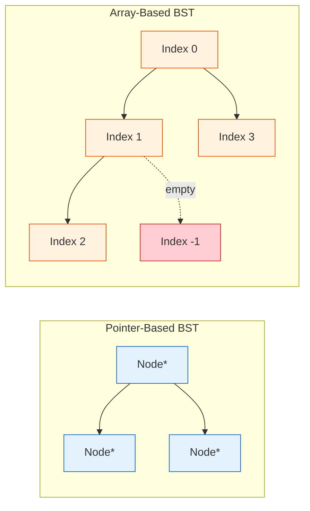
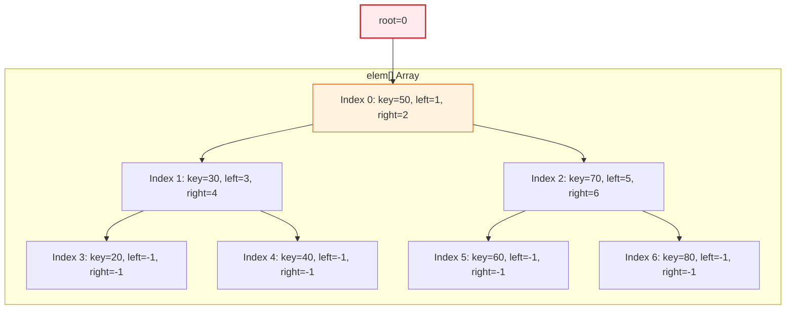
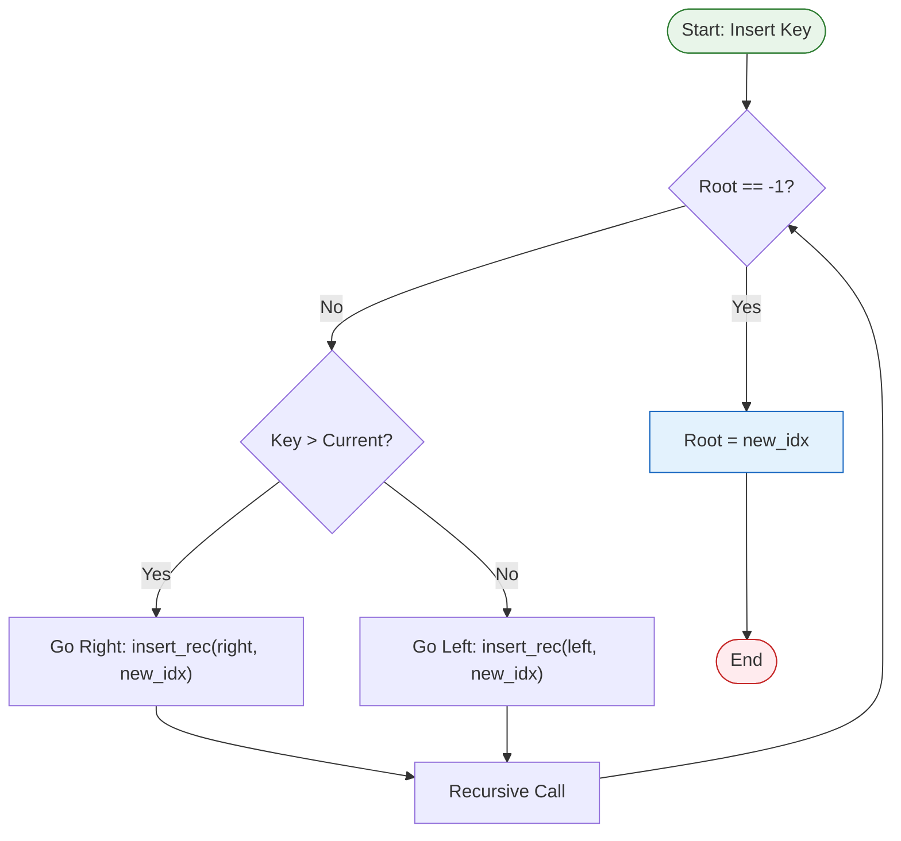

# Unit 3: BST Array Implementation

## 📊 BST Implementation 2: Array-Based

### Structure
```c
#define MAXSIZE 200

struct node {
    int key;
    int left;   // Index of left child (-1 = null)
    int right;  // Index of right child
};
typedef struct node node_t;

struct tree {
    int root;       // Index of root (-1 = empty)
    int count;      // Number of nodes
    node_t elem[MAXSIZE];
};
typedef struct tree tree_t;
```

### Array vs Pointer Comparison


### Array Representation Example


### Key Differences from Dynamic Version
- Uses **indices** instead of pointers
- `left`/`right` store array indices (-1 = null)
- `root` stores index of root node
- Copy tree = memcpy entire array!

### Insert
```c
int insert_rec(node_t e[], int root, int new_idx) {
    if (root == -1) return new_idx;
    if (e[root].key > e[new_idx].key)
        e[root].left = insert_rec(e, e[root].left, new_idx);
    else
        e[root].right = insert_rec(e, e[root].right, new_idx);
    return root;
}

void insert(tree_t *t, int key) {
    int idx = t->count++;
    t->elem[idx].key = key;
    t->elem[idx].left = t->elem[idx].right = -1;
    t->root = insert_rec(t->elem, t->root, idx);
}
```

### Insert Flow Visualization


---

## 📝 Key Takeaways

| Concept | Key Point |
|---------|-----------|
| **Array BST** | Uses indices instead of pointers |
| **left/right** | Store array indices (-1 = null) |
| **root** | Stores index of root node |
| **Copy tree** | memcpy entire array! |

---

*Next: [Expression Trees →](./unit3_04_expression_trees.md)*