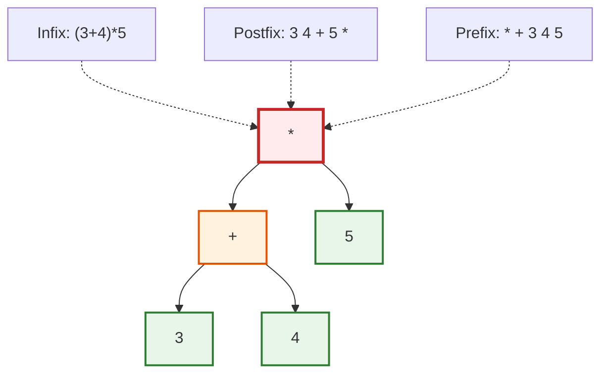
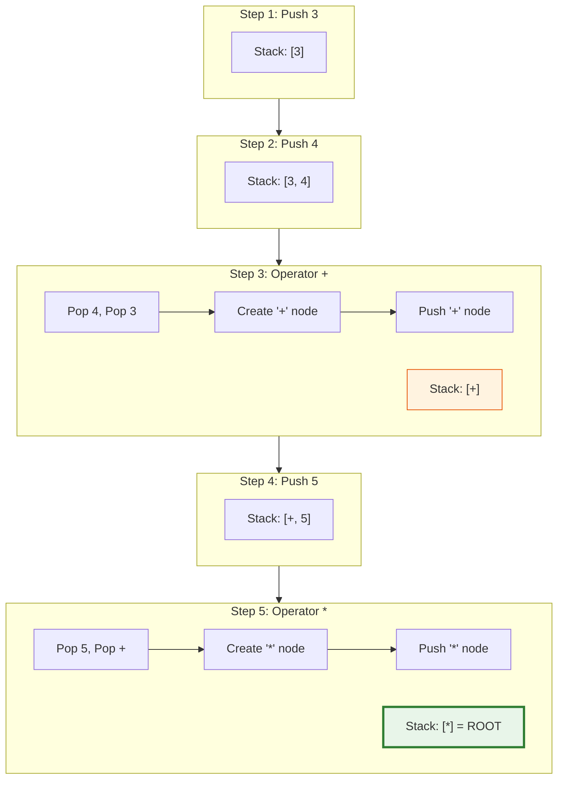
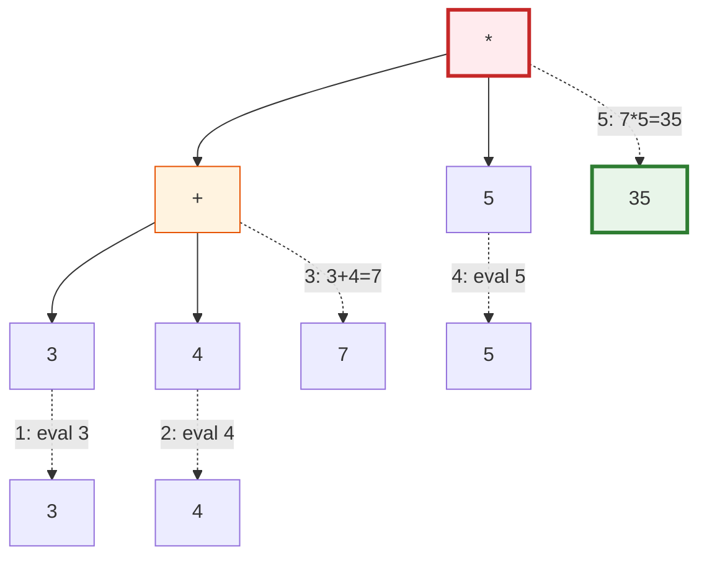

# Unit 3: Expression Trees

## 🌿 Expression Trees

### Concept
- **Leaves**: Operands (numbers)
- **Internal nodes**: Operators (+, -, *, /)
- **Inorder** = Infix expression
- **Postorder** = Postfix expression
- **Preorder** = Prefix expression

### Expression Tree Example


### Build from Postfix
```c
node_t* build_expression_tree(char *postfix) {
    node_t *stack[100];
    int top = -1;
    
    for (int i = 0; postfix[i]; i++) {
        char ch = postfix[i];
        if (isdigit(ch)) {
            // Operand: create node, push
            node_t *n = malloc(sizeof(node_t));
            n->key = ch; n->left = n->right = NULL;
            stack[++top] = n;
        } else {
            // Operator: pop 2, create node, push
            node_t *n = malloc(sizeof(node_t));
            n->key = ch;
            n->right = stack[top--];  // First popped = right
            n->left = stack[top--];   // Second popped = left
            stack[++top] = n;
        }
    }
    return stack[top];  // Root
}
```

### Build Process Visualization (Postfix: 3 4 + 5 *)


### Evaluate Expression Tree
```c
int eval(node_t *root) {
    if (!root->left && !root->right)  // Leaf = operand
        return root->key - '0';
    
    int left = eval(root->left);
    int right = eval(root->right);
    
    switch(root->key) {
        case '+': return left + right;
        case '-': return left - right;
        case '*': return left * right;
        case '/': return left / right;
    }
    return 0;
}
```

### Evaluation Visualization (Postorder Traversal)


---

## 📝 Key Takeaways

| Concept | Key Point |
|---------|-----------|
| **Expression Tree** | Leaves=operands, internal=operators |
| **Build from Postfix** | Stack-based, O(n) |
| **Evaluate** | Recursive postorder traversal |

---

*Next: [Threaded Binary Trees →](./unit3_05_threaded_binary_trees.md)*