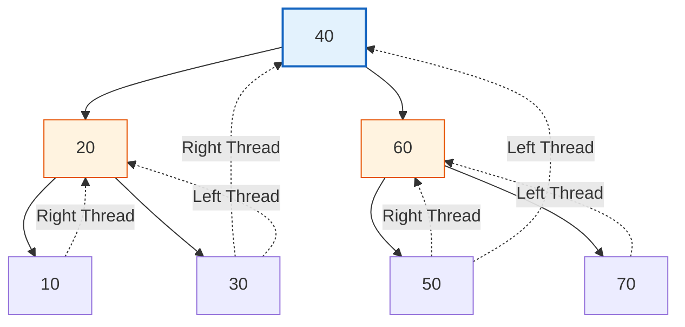
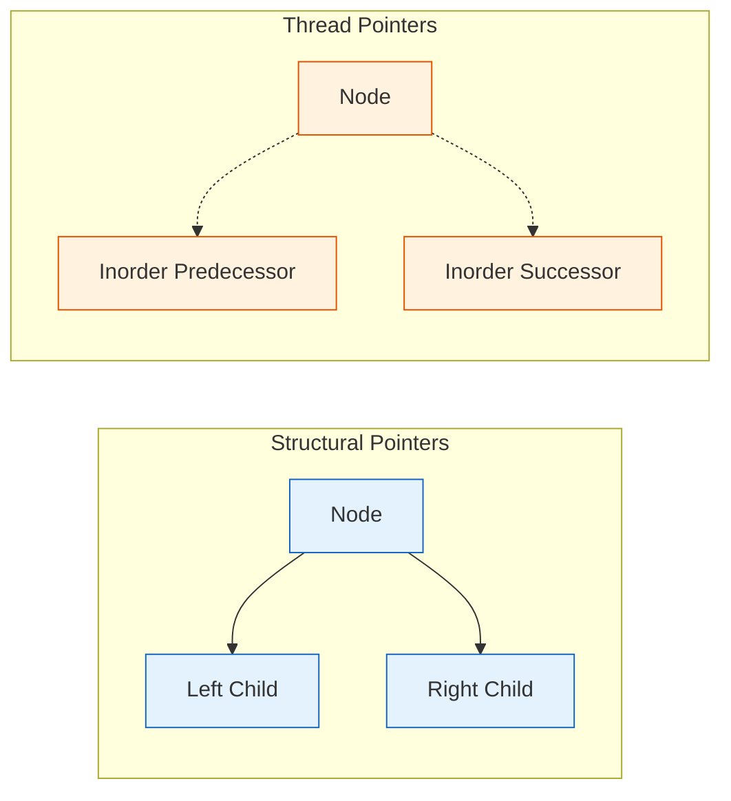
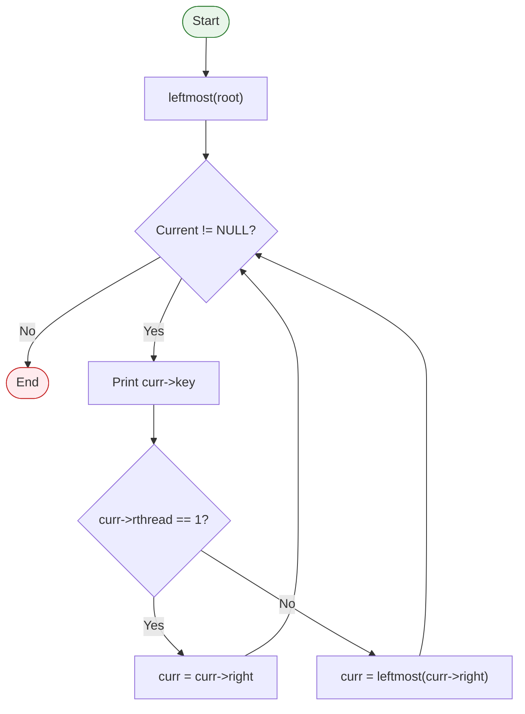

# Unit 3: Threaded Binary Trees

## 🧵 Threaded Binary Trees

### Problem
- n nodes → n-1 edges (structural pointers)
- 2n pointer fields → n+1 NULL pointers **wasted!**

### Solution: Threads
- Replace NULL pointers with **threads** to inorder predecessor/successor
- `lthread = 1` → left is thread (not structural)
- `rthread = 1` → right is thread

### Structure
```c
struct node {
    int key;
    struct node *left, *right;
    int lthread, rthread;  // 1 = thread, 0 = structural
};
```

### Threaded Tree Visualization


### Thread Types Visualization


### Inorder Traversal (Iterative - No Recursion!)
```c
node_t* leftmost(node_t *n) {
    if (!n) return NULL;
    while (n->lthread == 0) n = n->left;  // Follow structural
    return n;
}

void inorder(node_t *root) {
    node_t *curr = leftmost(root);
    while (curr) {
        printf("%d ", curr->key);
        if (curr->rthread == 1)
            curr = curr->right;      // Thread to successor
        else
            curr = leftmost(curr->right);  // Structural right
    }
}
```

### Inorder Traversal Flow


---

## 📝 Key Takeaways

| Concept | Key Point |
|---------|-----------|
| **Threaded Tree** | Threads replace NULL, O(1) successor |
| **lthread/rthread** | 1 = thread, 0 = structural |
| **Inorder** | Iterative, no recursion needed |

---

*Next: [Heaps →](./unit3_06_heaps.md)*