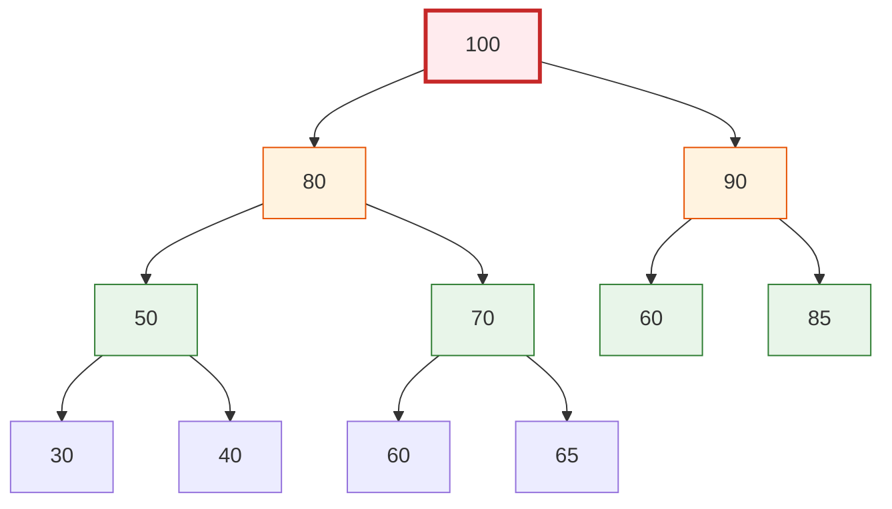
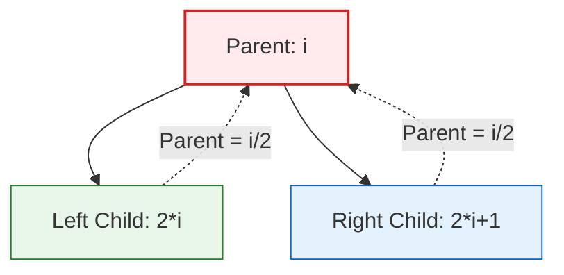
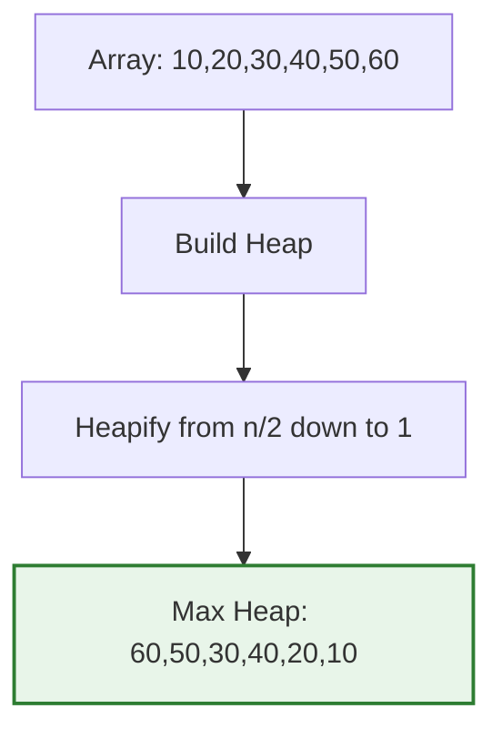
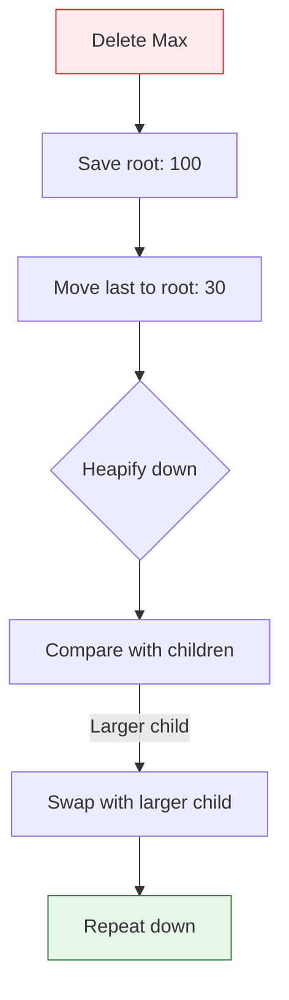

# Unit 3: Heaps

## 📦 Heaps

### Definition (Max-Heap)
> **Heap** = Complete Binary Tree + Parental Dominance
> 1. **Complete**: All levels full except last (left-filled)
> 2. **Parental Dominance**: Parent ≥ Children (recursively)

### Heap Visualization


### Array Representation (1-indexed)
```mermaid
graph LR
    subgraph Array[key[] Array - 1-indexed]
        I1[1: 100]
        I2[2: 80]
        I3[3: 90]
        I4[4: 50]
        I5[5: 70]
        I6[6: 60]
        I7[7: 85]
        I8[8: 30]
        I9[9: 40]
        I10[10: 60]
        I11[11: 65]
    end
    
    Root[Root=1] --> I1
    I1 --> I2
    I1 --> I2
    I1 --> I3
    I2 --> I4
    I2 --> I5
    I3 --> I6
    I3 --> I7
    I4 --> I8
    I4 --> I9
    I5 --> I10
    I5 --> I11
    
    style I1 fill:#ffebee,stroke:#c62828,stroke-width:3px
```

### Array Index Formulas


```
Left(i) = 2*i, Right(i) = 2*i+1, Parent(i) = i/2
```

### Structure
```c
#define MAXSIZE 100
struct heap {
    int key[MAXSIZE];
    int n;  // Number of elements
};
typedef struct heap heap_t;
```

### Core Operations

#### Heapify (Fix subtree at position i)
```c
void heapify(int a[], int n, int i) {
    int largest = i;
    int left = 2*i, right = 2*i + 1;
    
    if (left <= n && a[left] > a[largest]) largest = left;
    if (right <= n && a[right] > a[largest]) largest = right;
    
    if (largest != i) {
        swap(&a[i], &a[largest]);
        heapify(a, n, largest);
    }
}
```

### Heapify Visualization
```mermaid
flowchart TD
    Start([Start: heapify(i)]) --> FindLargest[Find Largest among i, left, right]
    FindLargest --> Compare{Largest != i?}
    Compare -- Yes --> Swap[Swap a[i] and a[largest]]
    Swap --> Recurse[heapify(largest)]
    Compare -- No --> Done[Done]
    Recurse --> Compare
    Done --> End([End])
    
    style Start fill:#e8f5e9,stroke:#2e7d32
    style End fill:#ffebee,stroke:#c62828
```

### Build Heap (O(n))
```c
void build_heap(heap_t *h, int a[], int n) {
    h->n = n;
    for (int i = 1; i <= n; i++) h->key[i] = a[i];
    for (int i = n/2; i >= 1; i--)  // Start from last internal node
        heapify(h->key, h->n, i);
}
```

### Build Heap Visualization


#### Insert (O(log n))
```c
void insert(heap_t *h, int key) {
    int i = ++h->n;
    h->key[i] = key;
    // Bubble up
    while (i > 1 && h->key[i] > h->key[i/2]) {
        swap(&h->key[i], &h->key[i/2]);
        i = i/2;
    }
}
```

### Insert Visualization (Bubble Up)
```mermaid
graph TD
    A[Insert 95] --> B[Add at end: i=7]
    B --> C{key[i] > key[i/2]?}
    C -- Yes --> D[Swap with parent]
    D --> E[i = i/2]
    E --> C
    C -- No --> F[Done]
    
    style A fill:#e8f5e9,stroke:#2e7d32
    style F fill:#ffebee,stroke:#c62828
```

#### Delete Max (O(log n))
```c
int delete_max(heap_t *h) {
    int max = h->key[1];
    h->key[1] = h->key[h->n--];  // Move last to root
    heapify(h->key, h->n, 1);    // Fix from root
    return max;
}
```

### Delete Max Visualization


### Heapsort (O(n log n))
```c
void heapsort(int a[], int n) {
    heap_t h; build_heap(&h, a, n);
    for (int i = n; i >= 1; i--)
        a[i] = delete_max(&h);  // Extract max to end
}
```

### Heapsort Visualization


### Priority Queue using Heap
```c
struct pqueue { heap_t h; };
void pq_enqueue(pqueue_t *q, int key) { insert(&q->h, key); }
int pq_dequeue(pqueue_t *q) { return delete_max(&q->h); }
// Both O(log n)!
```

---

## 📝 Key Takeaways

| Concept | Key Point |
|---------|-----------|
| **Heap** | Complete tree + parental dominance |
| **Array (1-indexed)** | Left=2i, Right=2i+1, Parent=i/2 |
| **Build Heap** | O(n) |
| **Insert/Delete** | O(log n) |
| **Heapsort** | O(n log n), in-place |
| **PQ with Heap** | Both O(log n) |

---

*Next: [AVL Trees →](./unit3_07_avl_trees.md)*