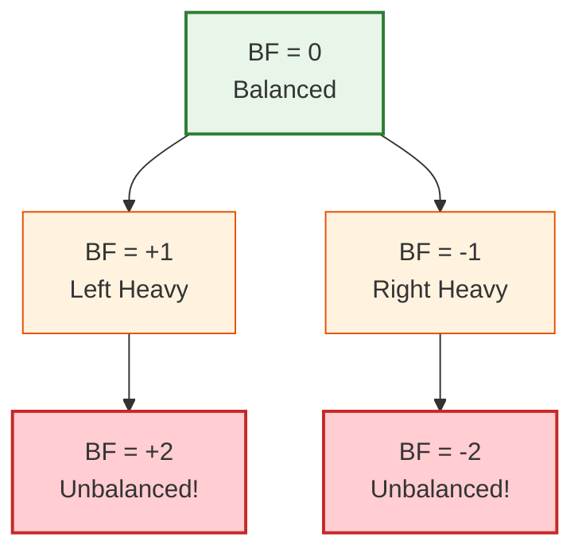
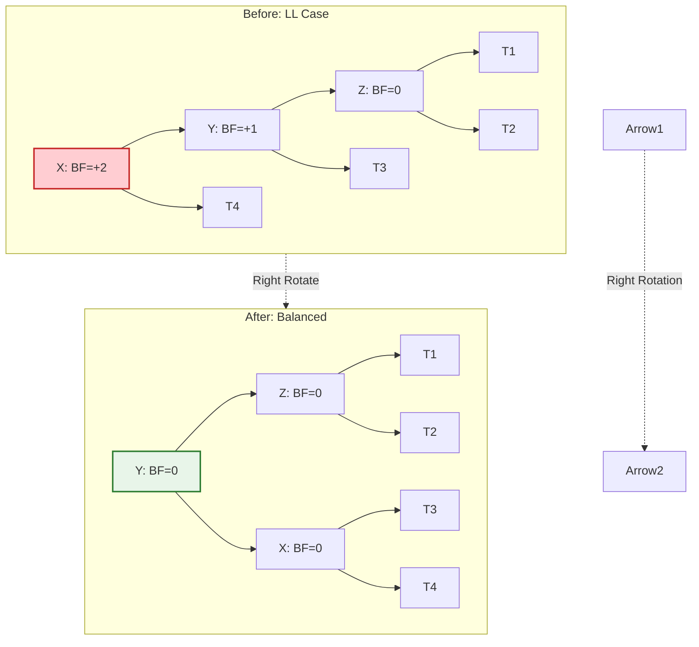
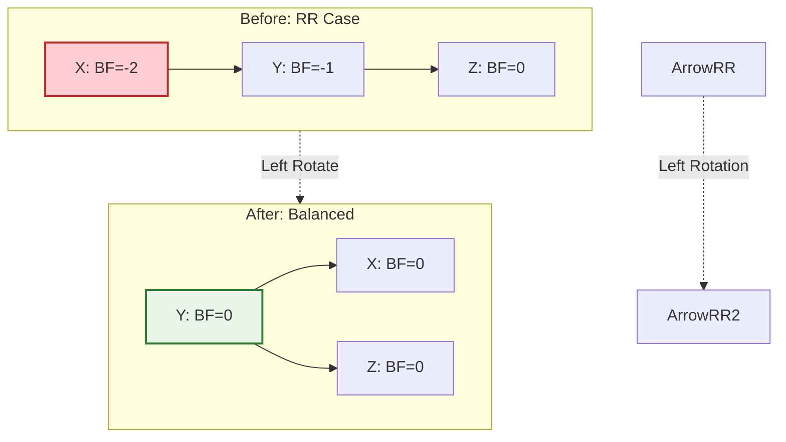
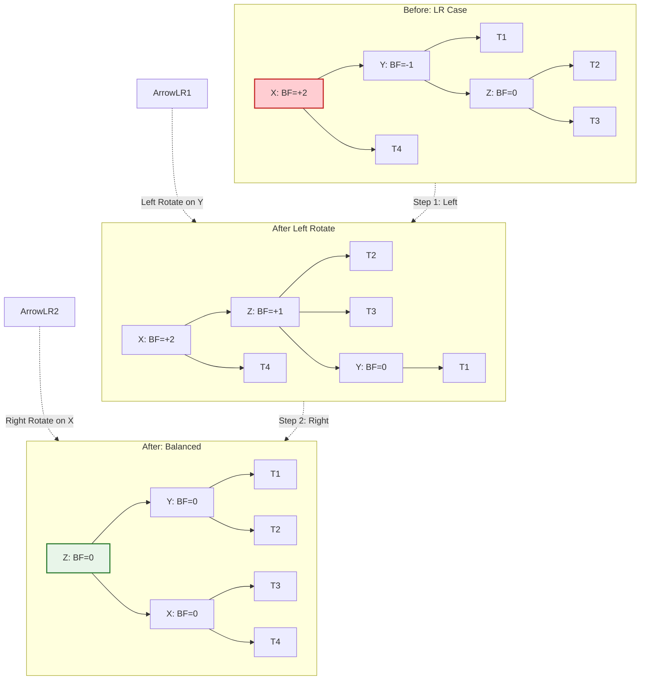
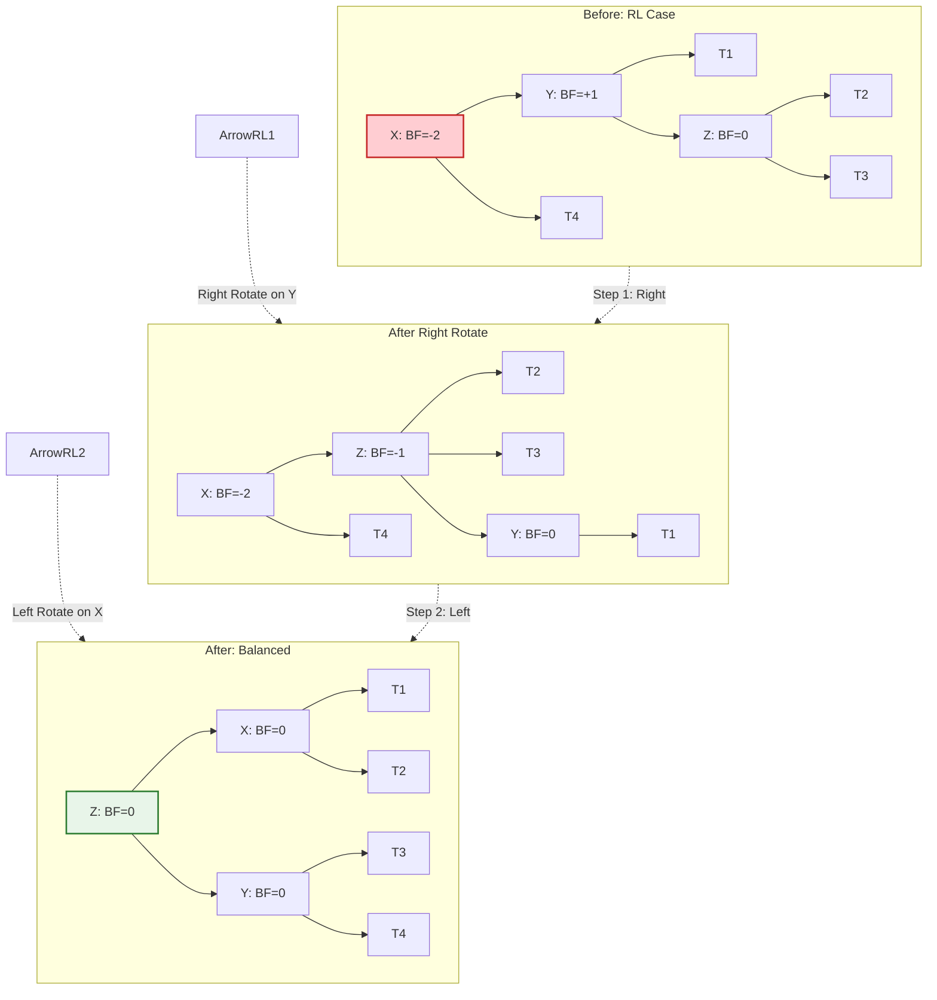
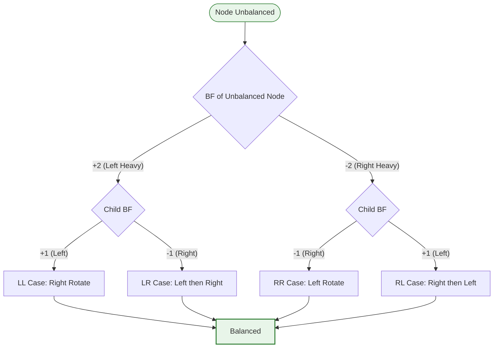

# Unit 3: AVL Trees

## ⚖️ AVL Trees (Balanced BST)

### Problem
- BST can become skewed → O(n) search
- Need **height-balanced** tree

### AVL Property
> For every node: |height(left) - height(right)| ≤ 1

**Balance Factor (BF)** = height(left) - height(right)
- BF ∈ {-1, 0, 1} → Balanced
- BF = +2 → Left heavy
- BF = -2 → Right heavy

### AVL Balance Factor Visualization

---

## 🔄 4 Rotation Cases

| Case | Pattern | Rotation |
|------|---------|----------|
| **LL** | Left-Left | Single Right |
| **RR** | Right-Right | Single Left |
| **LR** | Left-Right | Left then Right |
| **RL** | Right-Left | Right then Left |

**Memory Trick:** Same direction → Single rotation; Opposite → Double rotation

### LL Case - Single Right Rotation

### RR Case - Single Left Rotation

### LR Case - Double Rotation (Left then Right)

### RL Case - Double Rotation (Right then Left)

### Rotation Decision Flowchart

---

## 📝 Key Takeaways

| Concept | Key Insight |
|---------|-------------|
| **AVL** | Height-balanced, 4 rotation cases |
| **BF** | height(left) - height(right) |
| **Rotations** | Same direction = single, Opposite = double |

---

*Next: [Splay Trees →](./unit3_08_splay_trees.md)*