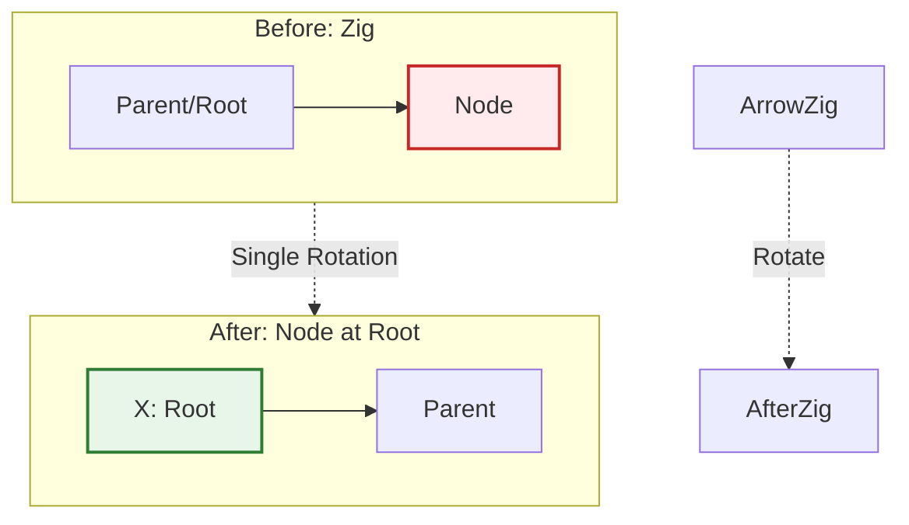
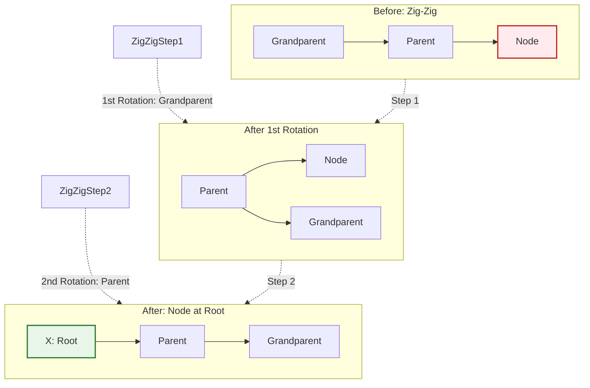
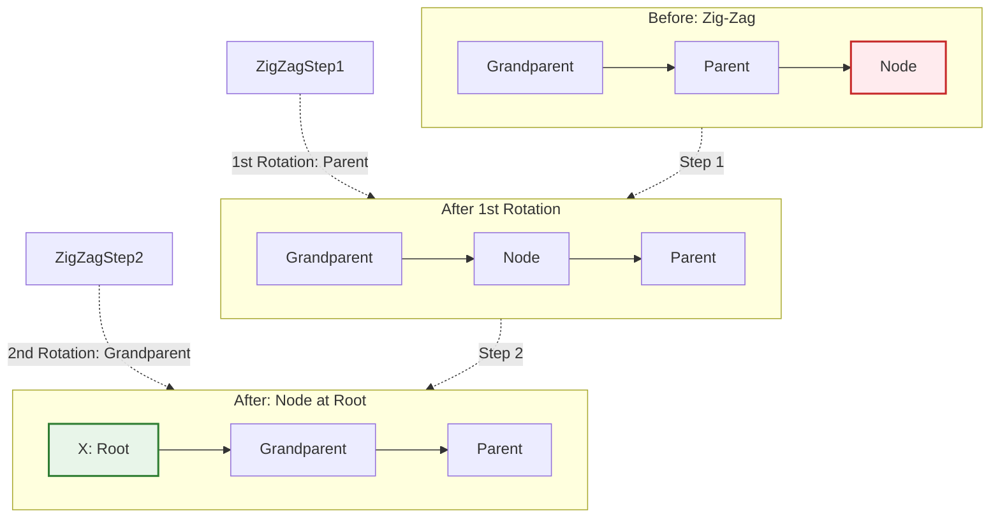
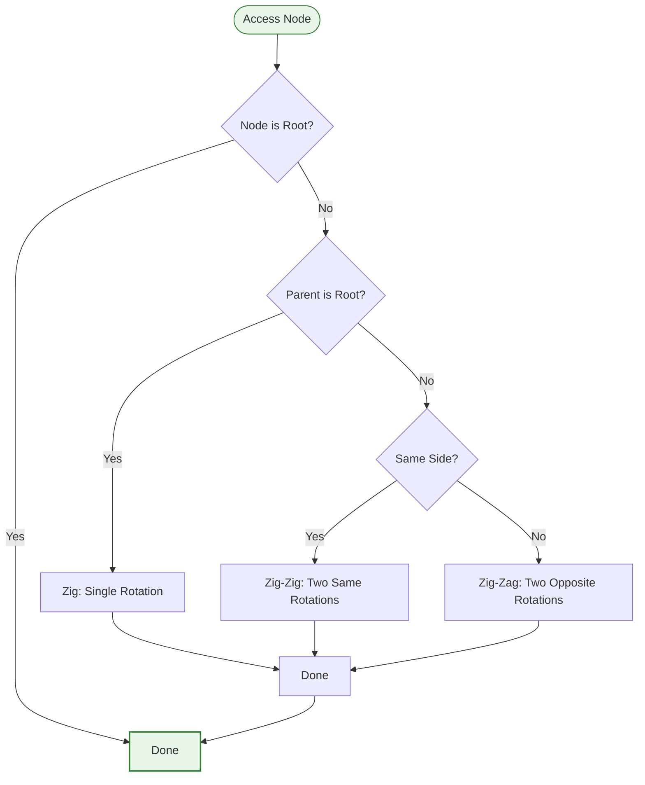

# Unit 3: Splay Trees

## 🎯 Splay Trees (Self-Adjusting)

### Concept
- No balance factors stored (memory efficient!)
- **Splay**: Move accessed node to root via rotations
- **Amortized** O(log n) for sequence of operations

### Splaying Cases
1. **Zig**: Node is child of root → single rotation
2. **Zig-Zig**: Node & parent same side → two same-direction rotations
3. **Zig-Zag**: Node & parent opposite sides → two opposite rotations

### Zig Case (Node is child of root)

### Zig-Zig Case (Node & parent same side - both left)

### Zig-Zag Case (Node & parent opposite sides)

### Splaying Decision Flowchart

### Applications
- Caches (recently accessed → root)
- Memory allocators
- Network routers (frequent IPs)

---

## 📝 Key Takeaways

| Concept | Key Insight |
|---------|-------------|
| **Splay** | Self-adjusting, amortized O(log n) |
| **No BF** | No balance factors stored |
| **Splaying** | Move accessed to root |

---

*Next: [Graphs →](./unit3_09_graphs.md)*