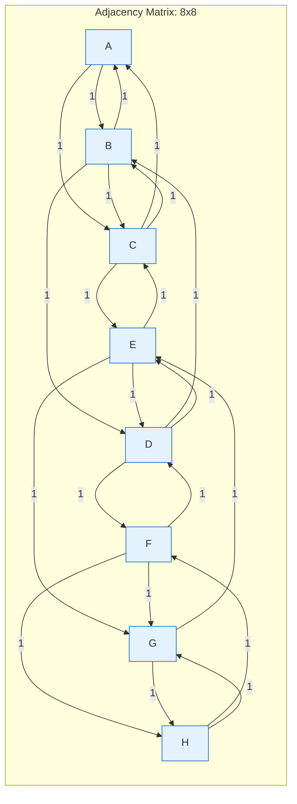
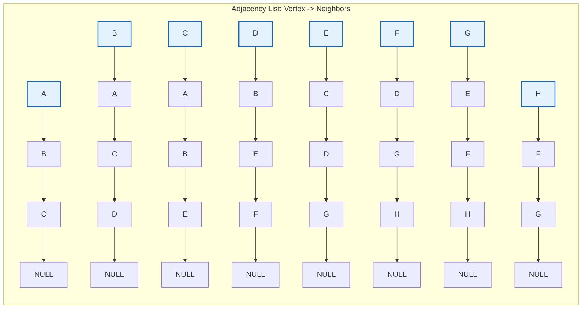
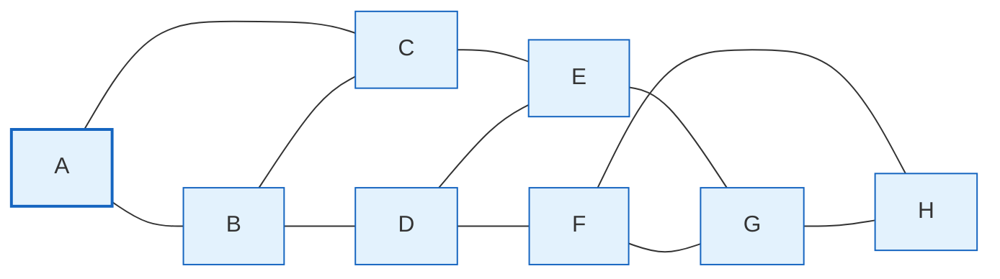
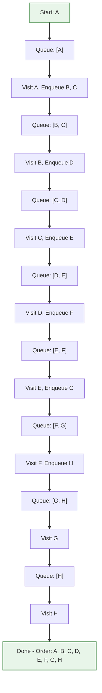
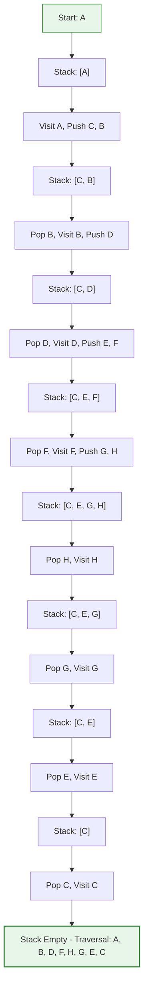
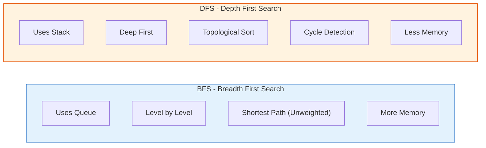
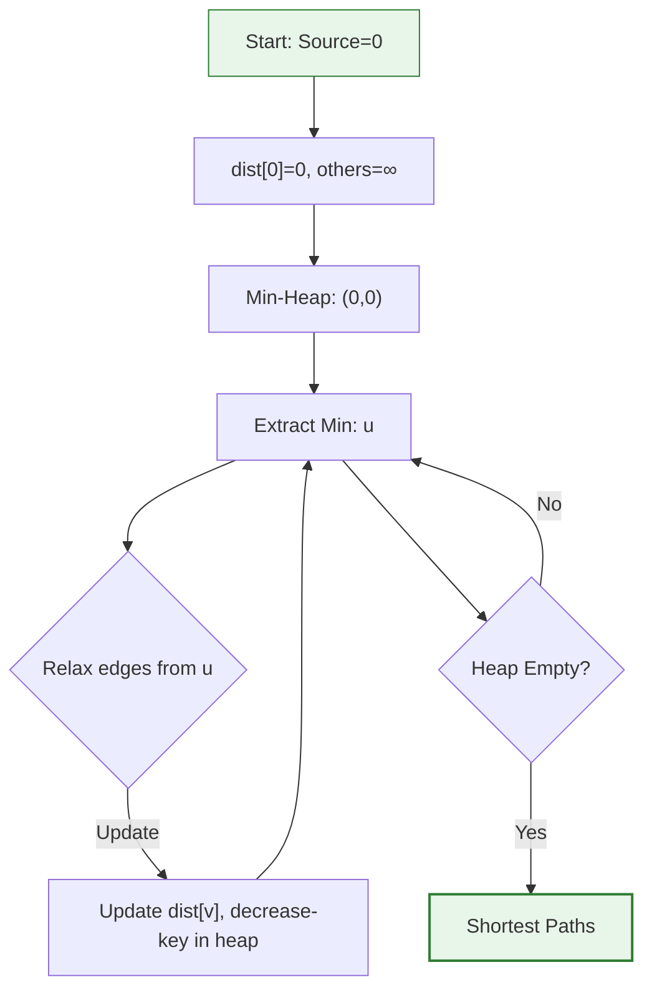
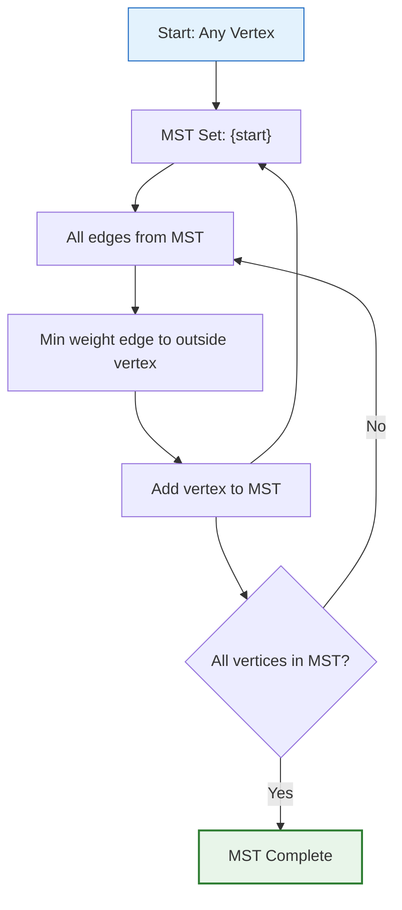
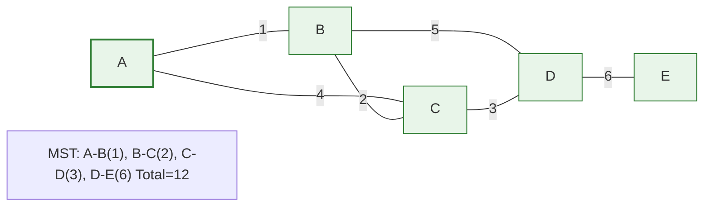

# Unit 3: Graphs

## 🌐 Graphs

### Definition
> **G = (V, E)** where V = vertices, E = edges

### Representations

#### 1. Adjacency Matrix
```c
int adj[MAXV][MAXV];
adj[u][v] = 1;  // Edge exists
adj[u][v] = w;  // Weight (weighted)
```
- Space: O(V²)
- Edge check: O(1)

### Adjacency Matrix Visualization


#### 2. Adjacency List
```c
struct node {
    int vertex;
    int weight;
    struct node *next;
};
typedef struct node node_t;

node_t *adj[MAXV];  // Array of linked lists
```
- Space: O(V + E)
- Traverse neighbors: O(degree)

### Adjacency List Visualization


### Example Graph Visualization


### Traversals

#### BFS (Breadth-First Search) - Uses Queue
```c
void bfs(int start) {
    queue_t q; init(&q);
    int visited[MAXV] = {0};
    enqueue(&q, start); visited[start] = 1;
    
    while (!is_empty(&q)) {
        int u = dequeue(&q);
        printf("%d ", u);
        for (node_t *p = adj[u]; p; p = p->next)
            if (!visited[p->vertex]) {
                visited[p->vertex] = 1;
                enqueue(&q, p->vertex);
            }
    }
}
```

### BFS Visualization


#### DFS (Depth-First Search) - Uses Stack
```c
void dfs(int start) {
    stack_t s; init(&s);
    int visited[MAXV] = {0};
    push(&s, start); visited[start] = 1;
    
    while (!is_empty(&s)) {
        int u = pop(&s);
        printf("%d ", u);
        for (node_t *p = adj[u]; p; p = p->next)
            if (!visited[p->vertex]) {
                visited[p->vertex] = 1;
                push(&s, p->vertex);
            }
    }
}
```

### DFS Visualization


### BFS vs DFS Comparison


### Graph Algorithms

#### Dijkstra's Shortest Path (Weighted, Non-negative)
- Uses **Min-Heap Priority Queue**
- Time: O((V+E) log V)

### Dijkstra's Algorithm Visualization


#### Prim's MST (Minimum Spanning Tree)
- Uses **Min-Heap Priority Queue**
- Time: O(E log V)

### Prim's MST Visualization


### Prim's MST Example


---

## 📝 Key Takeaways

| Concept | Key Insight |
|---------|-------------|
| **Graph** | V vertices, E edges, Matrix/List |
| **BFS** | Queue, shortest path (unweighted) |
| **DFS** | Stack, topological sort, cycles |
| **Dijkstra** | Min-heap, weighted shortest path |
| **Prim** | Min-heap, MST |

---

*Next: [Unit 3 Anchor Programs →](./unit3_10_anchor_programs.md)*