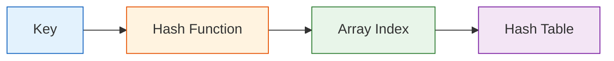
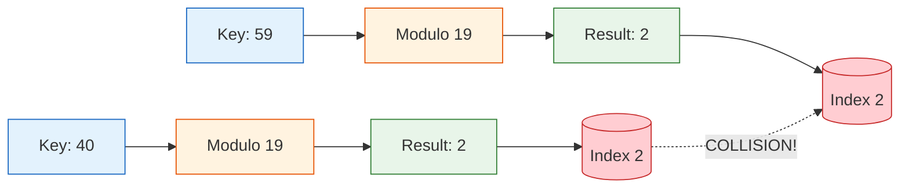
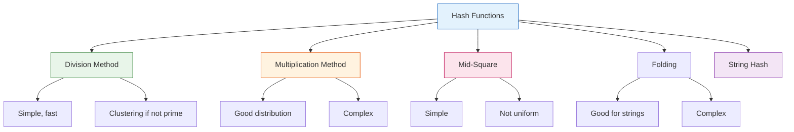

# Unit 4: Hashing & Hash Tables

## 🔑 Hashing - Complete Walkthrough

### What is Hashing?

> **Hashing** maps keys to array indices using a **hash function**.
> - Goal: O(1) average case for insert, search, delete
> - Key → Hash Function → Index (0 to TABLESIZE-1)

### Hashing Process Visualization


### Why Hashing?
| Scenario | Best Structure |
|----------|----------------|
| Dense integer keys | Direct array |
| Sparse integer keys | Hash table |
| String keys (identifiers) | Hash table |
| Repeated retrieval | Hash table |
| Compiler symbol tables | Hash table |

### Core Concepts

| Term | Definition |
|------|------------|
| **Key** | Unique identifier for a record |
| **Hash Function** | Maps key → array index |
| **Collision** | Two different keys → same index |
| **Overflow** | Table full, can't insert |

---

## 🎯 Hash Functions

### 1. Division Method (Most Common)
```c
h(k) = k % TABLESIZE
```
- TABLESIZE should be **prime** for better distribution
- Simple, fast

```c
int hash_division(int key) {
    return key % TABLESIZE;  // TABLESIZE = 19 (prime)
}
```

### Division Method Visualization


### 2. Multiplication Method
```c
h(k) = floor(TABLESIZE * frac(k * A))
```
- A = constant (e.g., 0.618033... golden ratio)
- Works well for non-integer keys

### 3. Mid-Square Method
```c
h(k) = middle digits of (k²)
```
- Example: k=44, 44²=1936, middle=93

### 4. Folding Method (Good for Strings)
```c
h(k) = sum of key parts
```
- Example: 123456 → 12+34+56 = 102

### String Hashing
```c
int hash_string(char *s) {
    int sum = 0;
    while (*s) sum += *s++;  // Sum ASCII values
    return sum % TABLESIZE;
}
```

### Hash Function Comparison


---

## 📝 Key Takeaways

| Concept | Key Point |
|---------|-----------|
| **Hashing** | Key → Index via hash function, O(1) average |
| **Hash Functions** | Division (prime table), Multiplication, Folding |
| **Collision** | Two keys → same index |

---

*Next: [Collision Resolution →](./unit4_02_collision_resolution.md)*