# Unit 4: Collision Resolution

## 💥 Collision Resolution

### Two Main Approaches

| Approach | Description | Pros | Cons |
|----------|-------------|------|------|
| **Open Hashing** (Separate Chaining) | Linked lists at each index | Simple, no overflow, easy delete | Extra memory for pointers, cache misses |
| **Closed Hashing** (Open Addressing) | Find next free slot in array | Better cache, no pointers | Clustering, hard delete, fixed size |

### Collision Visualization
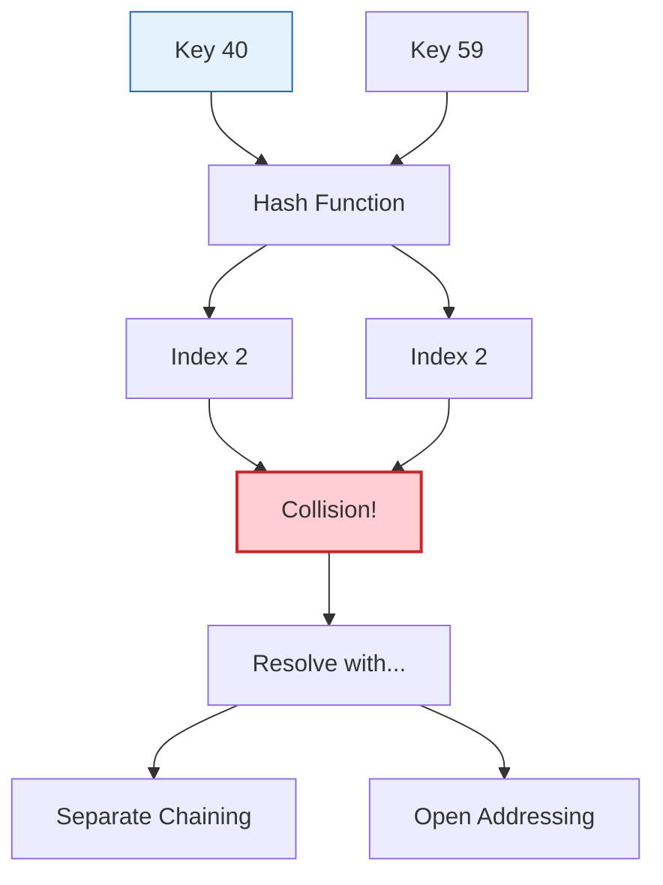

---

## 🔗 Method 1: Separate Chaining (Open Hashing)

### Structure
```c
#define TABLESIZE 19
#define WORDSIZE 32

struct node {
    int key;
    char word[WORDSIZE];
    struct node *next;
};
typedef struct node node_t;

struct hash_table {
    node_t *head[TABLESIZE];
};
typedef struct hash_table hash_table_t;
```

### Separate Chaining Visualization
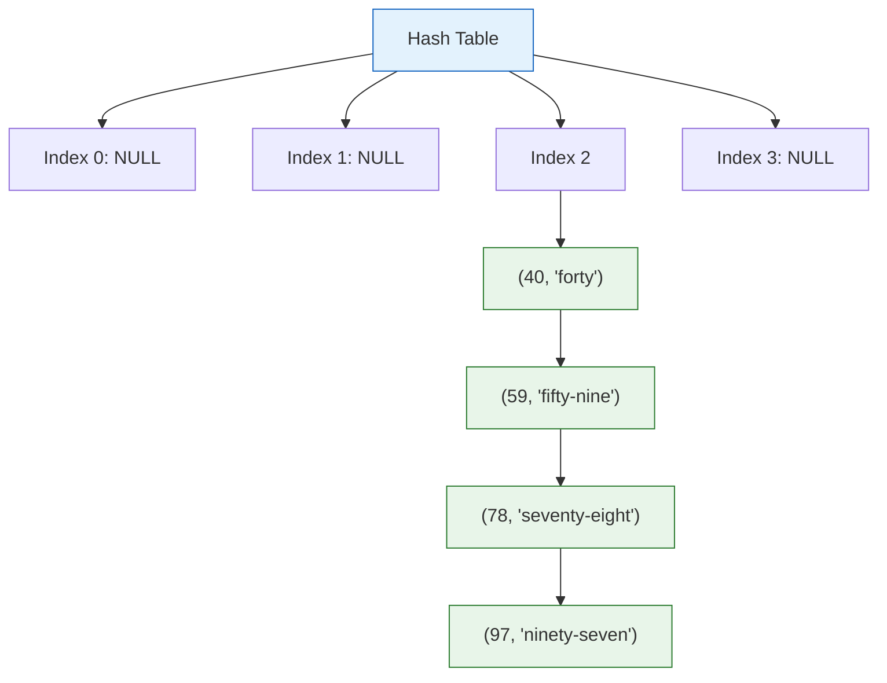

### Operations

#### Initialize
```c
void init_hash(hash_table_t *h) {
    for (int i = 0; i < TABLESIZE; i++) h->head[i] = NULL;
}
```

#### Insert
```c
void insert(hash_table_t *h, int key, char *word) {
    int idx = key % TABLESIZE;
    node_t *n = malloc(sizeof(node_t));
    n->key = key; strcpy(n->word, word); n->next = NULL;
    
    // Insert at front of list
    n->next = h->head[idx];
    h->head[idx] = n;
}
```

### Separate Chaining Insert Flow
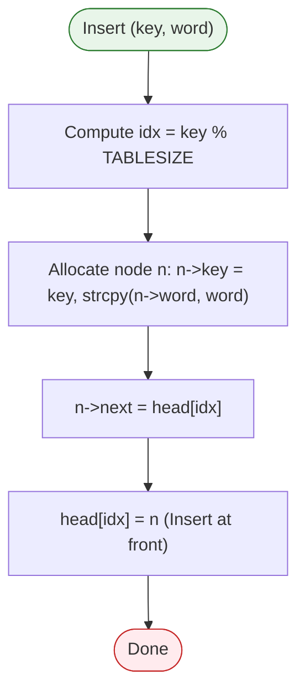

#### Search
```c
char* search(hash_table_t *h, int key) {
    int idx = key % TABLESIZE;
    for (node_t *p = h->head[idx]; p; p = p->next)
        if (p->key == key) return p->word;
    return "";
}
```

### Separate Chaining Search Flow
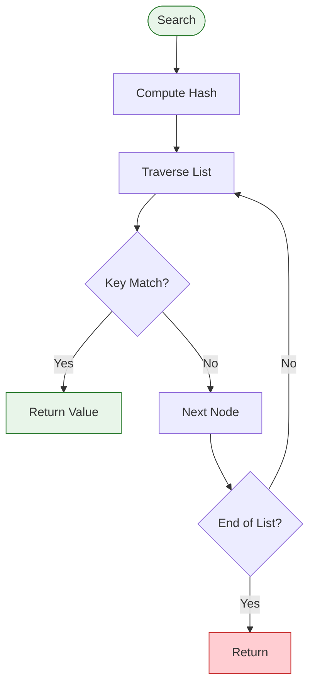

#### Delete
```c
void delete_key(hash_table_t *h, int key) {
    int idx = key % TABLESIZE;
    node_t *prev = NULL, *curr = h->head[idx];
    
    while (curr && curr->key != key) {
        prev = curr; curr = curr->next;
    }
    if (!curr) return;  // Not found
    
    if (!prev) h->head[idx] = curr->next;  // First node
    else prev->next = curr->next;
    
    free(curr);
}
```

#### Display
```c
void display(hash_table_t *h) {
    for (int i = 0; i < TABLESIZE; i++) {
        printf("Index %2d: ", i);
        for (node_t *p = h->head[i]; p; p = p->next)
            printf("(%d,%s) ", p->key, p->word);
        printf("\n");
    }
}
```

---

## 📦 Method 2: Linear Probing (Closed Hashing)

### Structure
```c
#define TABLESIZE 19

struct node {
    int in_use;  // 0 = free, 1 = occupied
    int key;
    char word[WORDSIZE];
};
typedef struct node node_t;

struct hash_table {
    node_t elem[TABLESIZE];
    int count;
};
typedef struct hash_table hash_table_t;
```

### Linear Probing Visualization
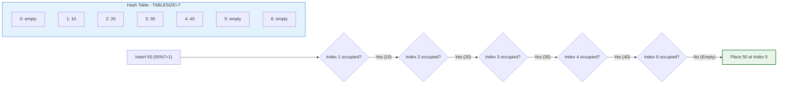

### Operations

#### Initialize
```c
void init_hash(hash_table_t *h) {
    h->count = 0;
    for (int i = 0; i < TABLESIZE; i++) h->elem[i].in_use = 0;
}
```

#### Insert
```c
void insert(hash_table_t *h, int key, char *word) {
    if (h->count == TABLESIZE) { printf("Full\n"); return; }
    
    int idx = key % TABLESIZE;
    while (h->elem[idx].in_use)  // Linear probe
        idx = (idx + 1) % TABLESIZE;
    
    h->elem[idx].key = key;
    strcpy(h->elem[idx].word, word);
    h->elem[idx].in_use = 1;
    h->count++;
}
```

### Linear Probing Flow
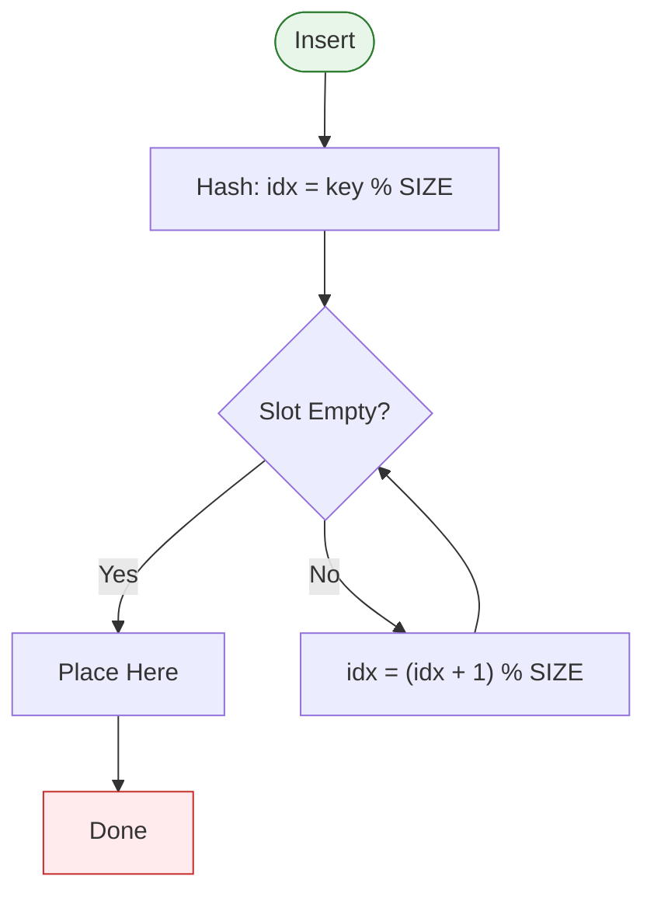

---

## 📐 Method 3: Quadratic Probing

### Probe Sequence
```c
idx = (init_idx + i*i) % TABLESIZE  // i = 0, 1, 2, ...
```

### Quadratic Probing Visualization
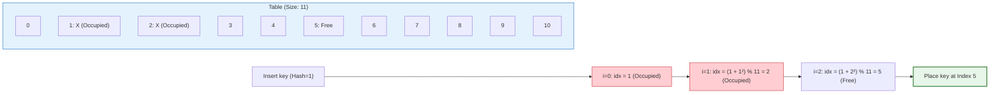

### Insert (Only Change from Linear)
```c
void insert(hash_table_t *h, int key, char *word) {
    if (h->count == TABLESIZE) return;
    
    int idx = key % TABLESIZE;
    int init_idx = idx;
    int i = 0;
    
    while (i < TABLESIZE && h->elem[idx].in_use) {
        i++;
        idx = (init_idx + i*i) % TABLESIZE;  // Quadratic step
    }
    
    h->elem[idx].key = key;
    strcpy(h->elem[idx].word, word);
    h->elem[idx].in_use = 1;
    h->count++;
}
```

### Probe Sequence Comparison
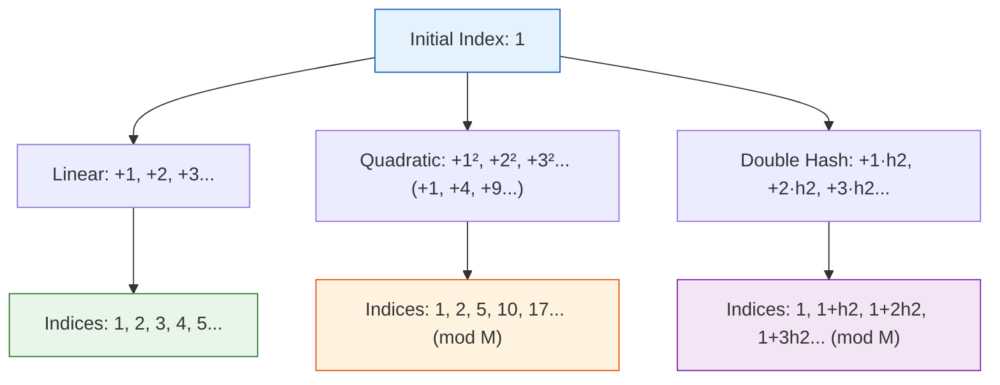

---

## 🔄 Method 4: Double Hashing

### Second Hash Function
```c
int hash2(int key) {
    return 7 - (key % 7);  // Returns 1..7 (prime < TABLESIZE)
}
```

### Double Hashing Flowchart
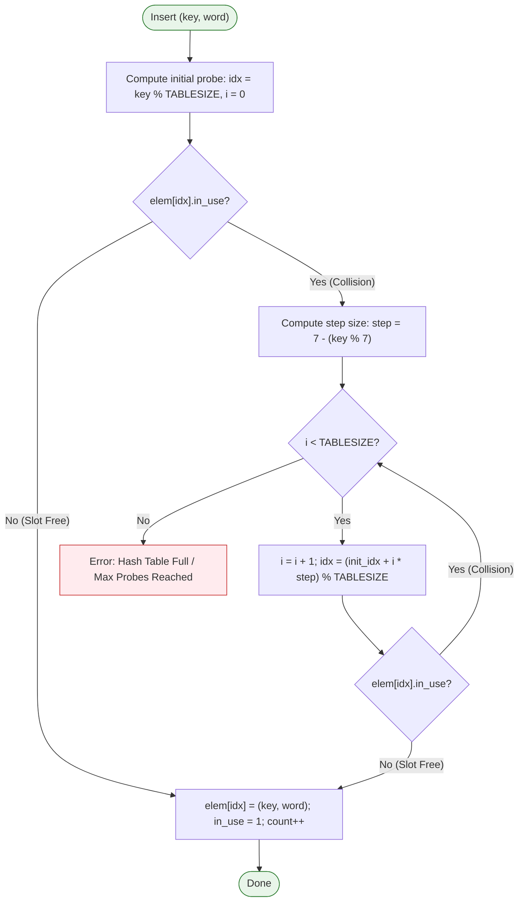

### Structure with Function Pointer
```c
struct hash_table {
    node_t elem[TABLESIZE];
    int count;
    int (*hash_fn)(int);  // Secondary hash function
};
```

### Initialize with Hash Function
```c
void init_hash(hash_table_t *h, int (*fn)(int)) {
    h->count = 0; h->hash_fn = fn;
    for (int i = 0; i < TABLESIZE; i++) h->elem[i].in_use = 0;
}
```

### Probe Sequence
```c
idx = (init_idx + i * hash_fn(key)) % TABLESIZE
```

### Insert
```c
void insert(hash_table_t *h, int key, char *word) {
    if (h->count == TABLESIZE) return;
    
    int idx = key % TABLESIZE;
    int init_idx = idx;
    int i = 0;
    
    while (i < TABLESIZE && h->elem[idx].in_use) {
        i++;
        idx = (init_idx + i * h->hash_fn(key)) % TABLESIZE;
    }
    
    h->elem[idx].key = key;
    strcpy(h->elem[idx].word, word);
    h->elem[idx].in_use = 1;
    h->count++;
}
```

### Double Hashing Trace Walkthrough
*Example: Table Size $M = 11$, Primary Hash $h_1(key) = key \pmod{11}$, Secondary Hash $h_2(key) = 7 - (key \pmod 7)$.*
*All three keys below initially collide at Index 3 ($25 \pmod{11} = 47 \pmod{11} = 69 \pmod{11} = 3$), but Double Hashing assigns distinct step sizes, dispersing them across the table without clustering:*

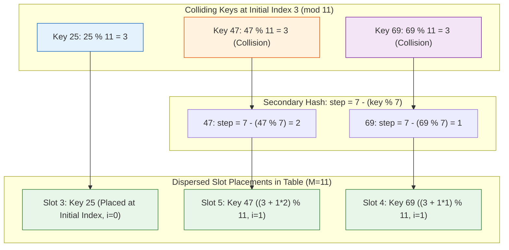

---

## 📊 Collision Resolution Comparison

| Method | Type | Insert | Search | Delete | Clustering | Cache |
|--------|------|--------|--------|--------|------------|-------|
| Separate Chaining | Open | O(1)* | O(1)* | Easy | None | Poor |
| Linear Probing | Closed | O(1)* | O(1)* | Lazy | Primary | Best |
| Quadratic Probing | Closed | O(1)* | O(1)* | Lazy | Secondary | Good |
| Double Hashing | Closed | O(1)* | O(1)* | Lazy | Minimal | Good |

*Average case, assuming good hash function and load factor < 0.7

### Comparison Visualization
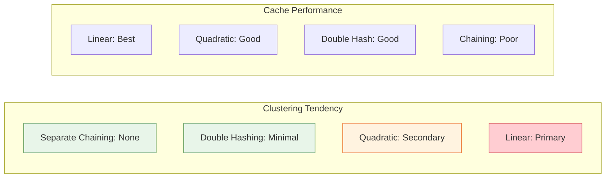

---

## 📝 Key Takeaways

| Concept | Key Insight |
|---------|-------------|
| **Collision** | Two keys → same index |
| **Separate Chaining** | Linked lists at each index, simple |
| **Linear Probing** | Next slot, primary clustering |
| **Quadratic Probing** | i² steps, secondary clustering |
| **Double Hashing** | Second hash function, minimal clustering |

---

*Next: [Tries →](./unit4_03_tries.md)*