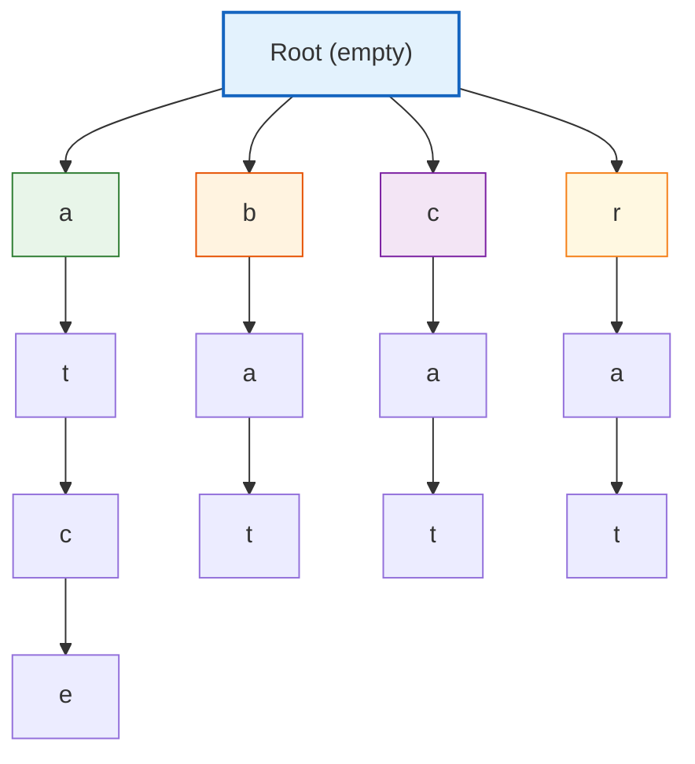
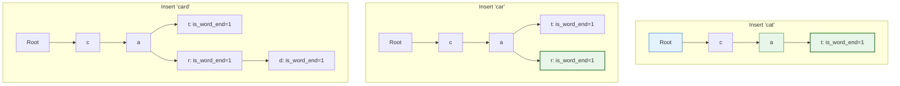
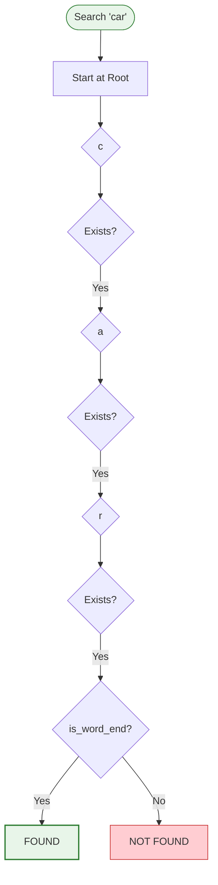
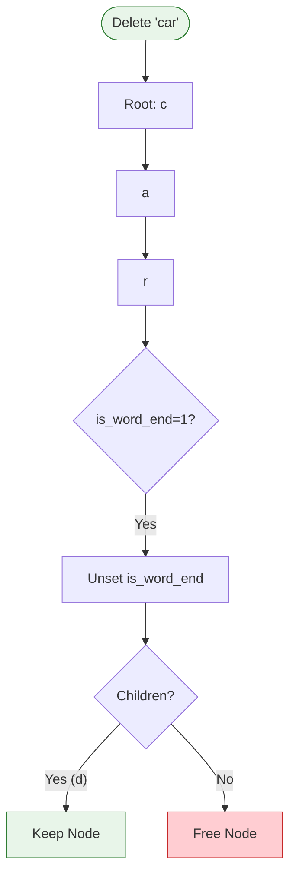
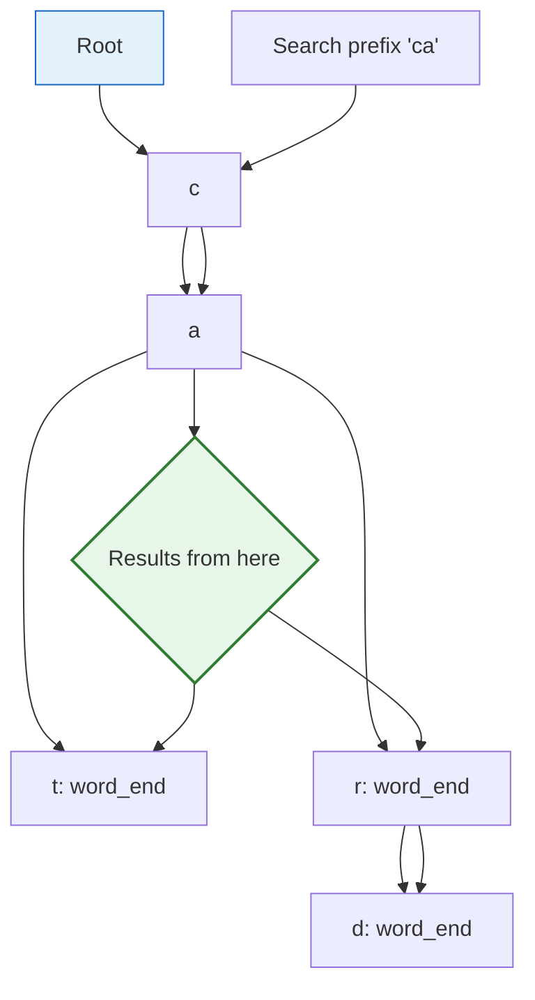

# Unit 4: Tries (Prefix Trees)

## 🌲 Tries (Prefix Trees)

### What is a Trie?
> **Trie** = Tree for storing strings, edges = characters
> - **Not a binary tree** - each node can have many children (alphabet size)
> - Root = empty prefix
> - Path from root = prefix
> - `is_word_end` flag marks complete words

### Trie Structure Visualization


### Structure
```c
#define ALPHABET_SIZE 256  // Extended ASCII

struct node {
    struct node *child[ALPHABET_SIZE];
    int is_word_end;
};
typedef struct node node_t;

struct trie {
    node_t *root;
};
typedef struct trie trie_t;
```

### Operations

#### Initialize
```c
void init_trie(trie_t *t) {
    t->root = calloc(1, sizeof(node_t));  // calloc zeros all pointers
}
```

#### Insert
```c
void insert(trie_t *t, char *word) {
    node_t *curr = t->root;
    for (int i = 0; word[i]; i++) {
        int idx = (unsigned char)word[i];
        if (!curr->child[idx])
            curr->child[idx] = calloc(1, sizeof(node_t));
        curr = curr->child[idx];
    }
    curr->is_word_end = 1;
}
```

### Insert Visualization (Inserting "cat", "car", "card")


#### Search
```c
int search(trie_t *t, char *word) {
    node_t *curr = t->root;
    for (int i = 0; word[i]; i++) {
        int idx = (unsigned char)word[i];
        if (!curr->child[idx]) return 0;
        curr = curr->child[idx];
    }
    return curr->is_word_end;
}
```

### Search Visualization


#### Delete
```c
// Returns 1 if node can be freed
int delete_rec(node_t *curr, char *word, int depth) {
    if (!curr) return 0;
    
    if (word[depth] == '\0') {
        if (!curr->is_word_end) return 0;
        curr->is_word_end = 0;
        // Can delete if no children
        for (int i = 0; i < ALPHABET_SIZE; i++)
            if (curr->child[i]) return 0;
        free(curr);
        return 1;
    }
    
    int idx = (unsigned char)word[depth];
    if (delete_rec(curr->child[idx], word, depth + 1)) {
        free(curr->child[idx]);
        curr->child[idx] = NULL;
        if (curr->is_word_end) return 0;
        for (int i = 0; i < ALPHABET_SIZE; i++)
            if (curr->child[i]) return 0;
        free(curr);
        return 1;
    }
    return 0;
}

void delete_word(trie_t *t, char *word) {
    delete_rec(t->root, word, 0);
}
```

### Delete Visualization


#### Display All Words
```c
void display_from(node_t *curr, char *prefix, int len) {
    if (curr->is_word_end) {
        prefix[len] = '\0';
        printf("%s\n", prefix);
    }
    for (int i = 0; i < ALPHABET_SIZE; i++)
        if (curr->child[i]) {
            prefix[len] = (char)i;
            display_from(curr->child[i], prefix, len + 1);
        }
}

void display(trie_t *t) {
    char prefix[100];
    display_from(t->root, prefix, 0);
}
```

#### Autocomplete (All words with prefix)
```c
void autocomplete(trie_t *t, char *prefix) {
    node_t *curr = t->root;
    for (int i = 0; prefix[i]; i++) {
        int idx = (unsigned char)prefix[i];
        if (!curr->child[idx]) return;  // Prefix not found
        curr = curr->child[idx];
    }
    // Display all words from this node
    char full_prefix[100];
    strcpy(full_prefix, prefix);
    display_from(curr, full_prefix, strlen(prefix));
}
```

### Autocomplete Visualization


---

## 📝 Key Takeaways

| Concept | Key Insight |
|---------|-------------|
| **Trie** | Prefix tree, edges = characters, O(L) search |
| **Trie Operations** | Insert, Search, Delete, Autocomplete |

---

*Next: [Suffix Trees →](./unit4_04_suffix_trees.md)*