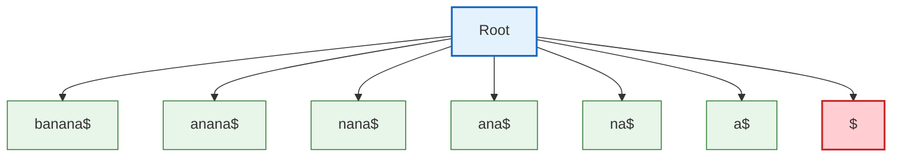
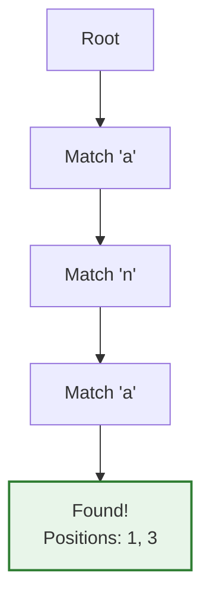

# Unit 4: Suffix Trees

## 🌿 Suffix Trees

### Problem
> Trie finds words/prefixes. What if we need **substring** search?

### Suffix Trie → Patricia Trie → Suffix Tree

#### Suffix Trie
- Trie of **all suffixes** of string T
- Every substring = prefix of some suffix
- Space: O(n²) - impractical!

### Suffix Trie Visualization (for "banana$")
```mermaid
graph TD
    Root[Root] --> B[b]
    B --> A1[a]
    A1 --> N1[n]
    N1 --> A2[a]
    A2 --> N2[n]
    N2 --> A3[a]
    A3 --> $[
    
    Root --> A1s[a]
    A1s --> N1s[n]
    N1s --> A2s[a]
    A2s --> N2s[n]
    A2s --> $[ 
    
    Root --> N1ss[n]
    N1ss --> A1ss[a]
    A1ss --> N2ss[n]
    A2ss --> A3ss[a]
    A3ss --> $[ 
    
    Root --> A1sss[a]
    A1sss --> $[ 
    Root --> $[ 
    
    style Root fill:#e3f2fd,stroke:#1565c0
    style $ fill:#ffcdd2,stroke:#c62828,stroke-width:2px
```

#### Patricia Trie (Compressed Trie)
- Merge "silly nodes" (single child)
- Chains of single-child nodes → single edge with string label
- Space: O(n)

### Patricia Trie Compression
```mermaid
graph TD
    subgraph Before[Before Compression]
        R[Root] --> B[b]
        B --> A1[a]
        A1 --> N1[n]
        N1 --> A2[a]
        A2 --> N2[n]
        N2 --> A3[a]
        A3 --> $[ 
    end
    
    Arrow1 -.->|Compress| After
    
    subgraph After[After Compression]
        R2[Root] --> E1[banana$]
        R2 --> E2[anana$]
        R2 --> E3[nana$]
        R2 --> E4[ana$]
        R2 --> E5[na$]
        R2 --> E6[a$]
        R2 --> E7[$]
    end
    
    style R fill:#e3f2fd,stroke:#1565c0
    style After fill:#e8f5e9,stroke:#2e7d32,stroke-width:2px
```

#### Suffix Tree
- Patricia Trie of all suffixes of T$ ($ = unique terminator)
- Each leaf = starting position of suffix
- Construction: O(n) with Ukkonen's algorithm
- Search: O(m) where m = pattern length

### Suffix Tree for "banana$"


### Search in Suffix Tree (Pattern "ana")


### Example: "banana$"
```
Suffixes: banana$, anana$, nana$, ana$, na$, a$, $
```
Compressed → Suffix Tree with edges labeled by string indices

### Applications
- Full-text search
- DNA sequence analysis
- Data compression
- Plagiarism detection

---

## 📝 Key Takeaways

| Concept | Key Insight |
|---------|-------------|
| **Suffix Tree** | Compressed trie of all suffixes, O(n) space |
| **Search** | O(m) where m = pattern length |

---

*Next: [Advanced Graph Algorithms →](./unit4_05_advanced_graph_algorithms.md)*