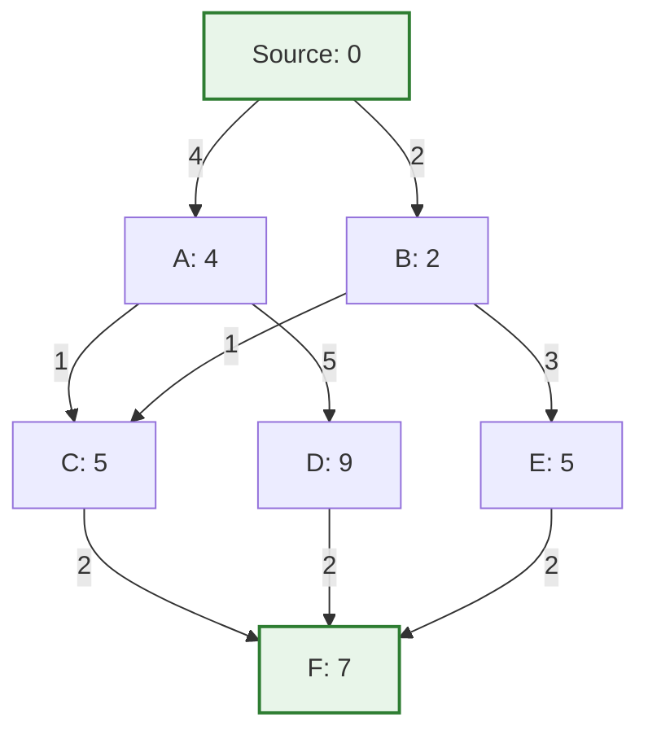

# Unit 4: Advanced Graph Algorithms

## 🌐 Advanced Graph Algorithms

### Dijkstra's Shortest Path
- **Single-source shortest path** (weighted, non-negative)
- Uses **Min-Heap Priority Queue**
- Time: O((V+E) log V)

```c
void dijkstra(int V, int src) {
    int dist[MAXV];
    for (int i = 0; i < V; i++) dist[i] = INF;
    dist[src] = 0;
    
    // Min-heap: (distance, vertex)
    pqueue_t pq; init(&pq);
    enqueue(&pq, src, 0);
    
    while (!is_empty(&pq)) {
        int u = dequeue_min(&pq);
        for (node_t *p = adj[u]; p; p = p->next) {
            int v = p->vertex, w = p->weight;
            if (dist[u] + w < dist[v]) {
                dist[v] = dist[u] + w;
                enqueue(&pq, v, dist[v]);  // Decrease key
            }
        }
    }
}
```

### Dijkstra's Algorithm Visualization
```mermaid
flowchart TD
    Start[Start: Source=0] --> Init[dist[0]=0, others=∞]
    Init --> PQ[Min-Heap: (0,0)]
    PQ --> Extract[Extract Min: u]
    Extract --> Relax{Relax edges<br/>from u}
    Relax -- Update --> Update[Update dist[v],<br/>decrease-key in heap]
    Update --> Extract
    Extract --> Done{Heap Empty?}
    Done -- No --> Extract
    Done -- Yes --> Result[Shortest Paths]
    
    style Start fill:#e8f5e9,stroke:#2e7d32
    style Result fill:#e8f5e9,stroke:#2e7d32,stroke-width:2px
```

### Dijkstra's Example


---

### Prim's Minimum Spanning Tree
- **MST**: Connect all vertices with minimum total edge weight
- Uses **Min-Heap Priority Queue**
- Time: O(E log V)

```c
void prim(int V, int start) {
    int key[MAXV], parent[MAXV];
    for (int i = 0; i < V; i++) { key[i] = INF; parent[i] = -1; }
    key[start] = 0;
    
    pqueue_t pq; init(&pq);
    for (int i = 0; i < V; i++) enqueue(&pq, i, key[i]);
    
    while (!is_empty(&pq)) {
        int u = dequeue_min(&pq);
        for (node_t *p = adj[u]; p; p = p->next) {
            int v = p->vertex, w = p->weight;
            if (in_queue(v) && w < key[v]) {
                key[v] = w; parent[v] = u;
                decrease_key(&pq, v, w);
            }
        }
    }
}
```

### Prim's MST Visualization
```mermaid
flowchart TD
    Start[Start: Any Vertex] --> MST[MST Set: {start}]
    MST --> Edges[All edges from MST]
    Edges --> MinEdge[Min weight edge<br/>to outside vertex]
    MinEdge --> Add[Add vertex<br/>to MST]
    Add --> MST
    Add --> Done{All vertices<br/>in MST?}
    Done -- No --> Edges
    Done -- Yes --> Result[MST Complete]
    
    style Start fill:#e3f2fd,stroke:#1565c0
    style Result fill:#e8f5e9,stroke:#2e7d32,stroke-width:2px
```

### Prim's MST Example
```mermaid
graph LR
    A[A] ---|1| B[B]
    A ---|4| C[C]
    B ---|2| C
    B ---|5| D[D]
    C ---|3| D
    D ---|6| E[E]
    
    style A fill:#e8f5e9,stroke:#2e7d32,stroke-width:2px
    style B fill:#e8f5e9,stroke:#2e7d32
    style C fill:#e8f5e9,stroke:#2e7d32
    style D fill:#e8f5e9,stroke:#2e7d32
    style E fill:#e8f5e9,stroke:#2e7d32
    
    MST[MST: A-B(1), B-C(2), C-D(3), D-E(6)<br/>Total=12]
```

---

## 📝 Key Takeaways

| Concept | Key Insight |
|---------|-------------|
| **Dijkstra** | Min-heap, O((V+E)log V), non-negative weights |
| **Prim's MST** | Min-heap, O(E log V) |

---

*Next: [Unit 4 Anchor Programs →](./unit4_06_anchor_programs.md)*