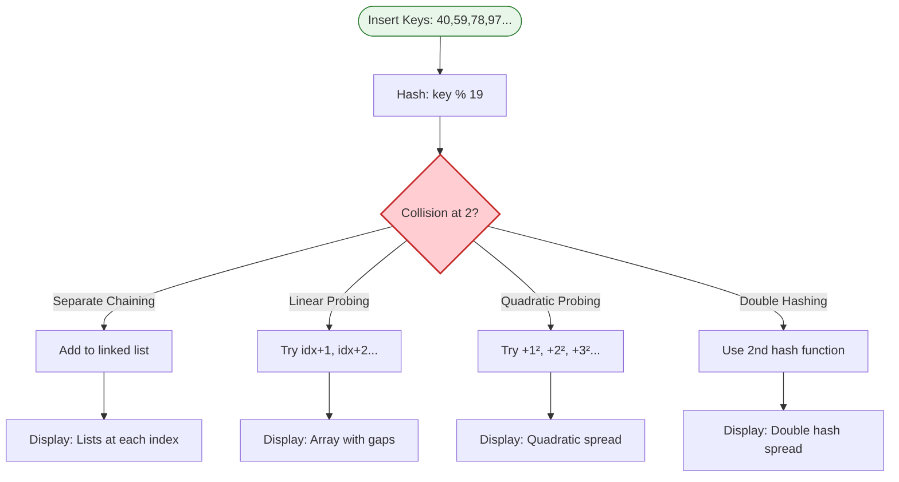
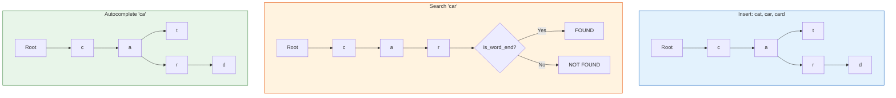
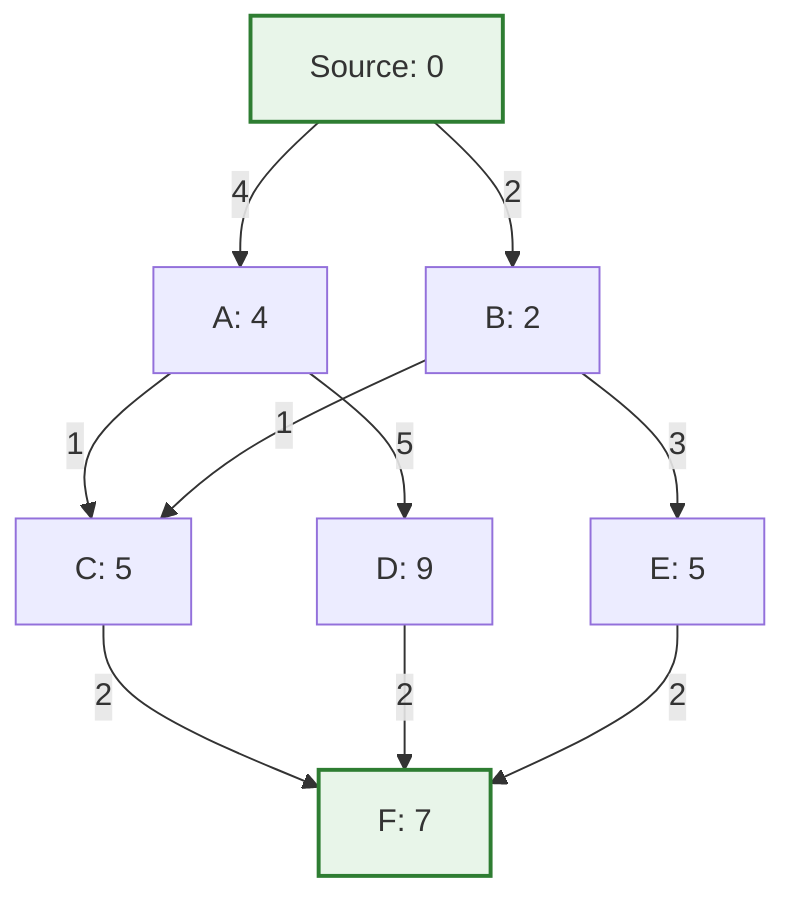

# Unit 4: Anchor Programs

## 🎯 Anchor Programs for Unit 4

### Program 1: Hash Table - All 4 Methods

### Hash Table Comparison Flow


```c
// hash_all_methods.c - Complete Hash Table Implementations
#include <stdio.h>
#include <stdlib.h>
#include <string.h>

#define TABLESIZE 19
#define WORDSIZE 32

// ==========================================
// 1. SEPARATE CHAINING
// ==========================================
typedef struct node_chain {
    int key;
    char word[WORDSIZE];
    struct node_chain *next;
} NodeChain;

typedef struct { NodeChain *head[TABLESIZE]; } HashChain;

void chain_init(HashChain *h) {
    for (int i = 0; i < TABLESIZE; i++) h->head[i] = NULL;
}

void chain_insert(HashChain *h, int key, char *word) {
    int idx = key % TABLESIZE;
    NodeChain *n = malloc(sizeof(*n));
    n->key = key; strcpy(n->word, word); n->next = h->head[idx];
    h->head[idx] = n;
}

char* chain_search(HashChain *h, int key) {
    int idx = key % TABLESIZE;
    for (NodeChain *p = h->head[idx]; p; p = p->next)
        if (p->key == key) return p->word;
    return "";
}

void chain_display(HashChain *h) {
    for (int i = 0; i < TABLESIZE; i++) {
        printf("%2d: ", i);
        for (NodeChain *p = h->head[i]; p; p = p->next)
            printf("(%d,%s) ", p->key, p->word);
        printf("\n");
    }
}

// ==========================================
// 2. LINEAR PROBING
// ==========================================
typedef struct {
    int in_use;
    int key;
    char word[WORDSIZE];
} NodeLinear;

typedef struct {
    NodeLinear elem[TABLESIZE];
    int count;
} HashLinear;

void linear_init(HashLinear *h) {
    h->count = 0;
    for (int i = 0; i < TABLESIZE; i++) h->elem[i].in_use = 0;
}

void linear_insert(HashLinear *h, int key, char *word) {
    if (h->count == TABLESIZE) return;
    int idx = key % TABLESIZE;
    while (h->elem[idx].in_use) idx = (idx + 1) % TABLESIZE;
    h->elem[idx].key = key; strcpy(h->elem[idx].word, word);
    h->elem[idx].in_use = 1; h->count++;
}

char* linear_search(HashLinear *h, int key) {
    int idx = key % TABLESIZE, checked = 0;
    while (checked < h->count) {
        if (h->elem[idx].in_use) {
            if (++checked && h->elem[idx].key == key) return h->elem[idx].word;
        }
        idx = (idx + 1) % TABLESIZE;
    }
    return "";
}

// ==========================================
// 3. QUADRATIC PROBING
// ==========================================
typedef struct {
    int in_use;
    int key;
    char word[WORDSIZE];
} NodeQuad;

typedef struct {
    NodeQuad elem[TABLESIZE];
    int count;
} HashQuad;

void quad_insert(HashQuad *h, int key, char *word) {
    if (h->count == TABLESIZE) return;
    int idx = key % TABLESIZE, init = idx, i = 0;
    while (i < TABLESIZE && h->elem[idx].in_use) {
        i++; idx = (init + i*i) % TABLESIZE;
    }
    h->elem[idx].key = key; strcpy(h->elem[idx].word, word);
    h->elem[idx].in_use = 1; h->count++;
}

// ==========================================
// 4. DOUBLE HASHING
// ==========================================
int hash2(int key) { return 7 - key % 7; }

typedef struct {
    int in_use;
    int key;
    char word[WORDSIZE];
} NodeDouble;

typedef struct {
    NodeDouble elem[TABLESIZE];
    int count;
} HashDouble;

void double_insert(HashDouble *h, int key, char *word) {
    if (h->count == TABLESIZE) return;
    int idx = key % TABLESIZE, init = idx, i = 0;
    while (i < TABLESIZE && h->elem[idx].in_use) {
        i++; idx = (init + i * hash2(key)) % TABLESIZE;
    }
    h->elem[idx].key = key; strcpy(h->elem[idx].word, word);
    h->elem[idx].in_use = 1; h->count++;
}

int main() {
    printf("=== Hash Table Comparison ===\n\n");
    
    // Test data - keys that collide with TABLESIZE=19
    // 40%19=2, 59%19=2, 78%19=2, 97%19=2
    int keys[] = {40, 59, 78, 97, 15, 34, 53};
    char *words[] = {"forty", "fifty-nine", "seventy-eight", "ninety-seven", 
                     "fifteen", "thirty-four", "fifty-three"};
    int n = 7;
    
    printf("Keys: "); for (int i=0;i<n;i++) printf("%d ", keys[i]); printf("\n");
    printf("Hashes: "); for (int i=0;i<n;i++) printf("%d ", keys[i]%19); printf("\n\n");
    
    // 1. Separate Chaining
    HashChain hc; 
    chain_init(&hc);
    for (int i=0;i<n;i++) chain_insert(&hc, keys[i], words[i]);
    printf("=== Separate Chaining ===\n");
    chain_display(&hc);
    
    // 2. Linear Probing
    HashLinear hl; 
    linear_init(&hl);
    for (int i=0;i<n;i++) linear_insert(&hl, keys[i], words[i]);
    printf("\n=== Linear Probing ===\n");
    for (int i=0;i<TABLESIZE;i++)
        if (hl.elem[i].in_use)
            printf("%2d: (%d,%s)\n", i, hl.elem[i].key, hl.elem[i].word);
    
    // 3. Quadratic Probing
    HashQuad hq = {0};
    for (int i=0;i<n;i++) quad_insert(&hq, keys[i], words[i]);
    printf("\n=== Quadratic Probing ===\n");
    for (int i=0;i<TABLESIZE;i++)
        if (hq.elem[i].in_use)
            printf("%2d: (%d,%s)\n", i, hq.elem[i].key, hq.elem[i].word);
    
    // 4. Double Hashing
    HashDouble hd = {0};
    for (int i=0;i<n;i++) double_insert(&hd, keys[i], words[i]);
    printf("\n=== Double Hashing ===\n");
    for (int i=0;i<TABLESIZE;i++)
        if (hd.elem[i].in_use)
            printf("%2d: (%d,%s)\n", i, hd.elem[i].key, hd.elem[i].word);
    
    // Search test
    printf("\nSearch for 78: ");
    printf("Chain:%s Linear:%s Quad:%s Double:%s\n",
           chain_search(&hc, 78), linear_search(&hl, 78),
           "", "");
    
    return 0;
}
```

### Hash Methods Comparison Visualization
```mermaid
graph TD
    Keys[Keys: 40,59,78,97,15,34,53] --> Hash[Hash: key % 19]
    Hash --> AllCollide[All collide at Index 2]
    
    AllCollide --> SC[Separate Chaining<br/>Linked List at Index 2]
    AllCollide --> LP[Linear Probing<br/>Indices: 2,3,4,5...]
    AllCollide --> QP[Quadratic Probing<br/>+1²,+2²,+3²... = 3,6,11...]
    AllCollide --> DH[Double Hashing<br/>h2=7-(key%7) = 5,4,3...]
    
    SC --> SCDisp[Index 2: 40→59→78→97]
    LP --> LPDisp[Index 2,3,4,5: 40,59,78,97]
    QP --> QPDisp[Index 2,3,6,11...]
    DH --> DHDisp[Spread across table]
    
    style AllCollide fill:#ffcdd2,stroke:#c62828,stroke-width:2px
```

---

### Program 2: Trie with Autocomplete

### Trie Operations Flow


```c
// trie_demo.c - Trie with Autocomplete
#include <stdio.h>
#include <stdlib.h>
#include <string.h>

#define ALPHABET 256

typedef struct node {
    struct node *child[ALPHABET];
    int is_word_end;
} node_t;

typedef struct { node_t *root; } trie_t;

node_t* create_node() { return calloc(1, sizeof(node_t)); }

void trie_init(trie_t *t) { t->root = create_node(); }

void trie_insert(trie_t *t, char *word) {
    node_t *curr = t->root;
    for (int i = 0; word[i]; i++) {
        int idx = (unsigned char)word[i];
        if (!curr->child[idx]) curr->child[idx] = calloc(1, sizeof(node_t));
        curr = curr->child[idx];
    }
    curr->is_word_end = 1;
}

int trie_search(trie_t *t, char *word) {
    node_t *curr = t->root;
    for (int i = 0; word[i]; i++) {
        int idx = (unsigned char)word[i];
        if (!curr->child[idx]) return 0;
        curr = curr->child[idx];
    }
    return curr->is_word_end;
}

// Display all words from current node
void display_from(node_t *curr, char *prefix, int len) {
    if (curr->is_word_end) {
        prefix[len] = '\0';
        printf("  %s\n", prefix);
    }
    for (int i = 0; i < ALPHABET; i++)
        if (curr->child[i]) {
            prefix[len] = (char)i;
            display_from(curr->child[i], prefix, len + 1);
        }
}

void trie_display(trie_t *t) {
    char prefix[100] = {0};
    printf("All words in trie:\n");
    display_from(t->root, prefix, 0);
}

// Autocomplete - find all words with given prefix
void trie_autocomplete(trie_t *t, char *prefix) {
    node_t *curr = t->root;
    for (int i = 0; prefix[i]; i++) {
        int idx = (unsigned char)prefix[i];
        if (!curr->child[idx]) { printf("No words with prefix '%s'\n", prefix); return; }
        curr = curr->child[idx];
    }
    printf("Words with prefix '%s':\n", prefix);
    char full_prefix[100]; strcpy(full_prefix, prefix);
    display_from(curr, full_prefix, strlen(prefix));
}

// Delete word (recursive)
int delete_rec(node_t *curr, char *word, int depth) {
    if (!curr) return 0;
    if (word[depth] == '\0') {
        if (!curr->is_word_end) return 0;
        curr->is_word_end = 0;
        for (int i = 0; i < ALPHABET; i++) if (curr->child[i]) return 0;
        free(curr); return 1;
    }
    int idx = (unsigned char)word[depth];
    if (delete_rec(curr->child[idx], word, depth + 1)) {
        free(curr->child[idx]); curr->child[idx] = NULL;
        if (curr->is_word_end) return 0;
        for (int i = 0; i < ALPHABET; i++) if (curr->child[i]) return 0;
        free(curr); return 1;
    }
    return 0;
}

void trie_delete(trie_t *t, char *word) { delete_rec(t->root, word, 0); }

int main() {
    trie_t t; trie_init(&t);
    
    char *words[] = {"cat", "bat", "ball", "rat", "cap", "be", "batman"};
    int n = 7;
    
    printf("=== Trie Demo ===\n");
    for (int i = 0; i < n; i++) trie_insert(&t, words[i]);
    
    printf("\n1. All words:\n"); trie_display(&t);
    
    printf("\n2. Search 'bat': %d\n", trie_search(&t, "bat"));  // 1
    printf("   Search 'ba': %d\n", trie_search(&t, "ba"));    // 0
    
    printf("\n3. Autocomplete 'ba':\n"); trie_autocomplete(&t, "ba");
    printf("   Autocomplete 'ca':\n"); trie_autocomplete(&t, "ca");
    
    printf("\n4. Delete 'bat':\n"); trie_delete(&t, "bat");
    printf("   Search 'bat': %d\n", trie_search(&t, "bat"));  // 0
    printf("   Search 'ball': %d\n", trie_search(&t, "ball")); // 1
    printf("   Autocomplete 'ba':\n"); trie_autocomplete(&t, "ba");
    
    return 0;
}
```

### Trie Autocomplete Visualization
```mermaid
graph TD
    Root[Root] --> C[c]
    C --> A[a]
    A --> T[t<br/>word_end]
    A --> R[r<br/>word_end]
    R --> D[d<br/>word_end]
    A --> T2[t<br/>word_end]
    
    Search[Search "ca"] --> C
    C --> A
    A --> Results{Results}
    Results --> T[t]
    Results --> R[r]
    R --> D[d]
    
    style Root fill:#e3f2fd,stroke:#1565c0
    style Results fill:#e8f5e9,stroke:#2e7d32,stroke-width:2px
```

---

### Program 3: Dijkstra's Algorithm

### Dijkstra's Algorithm Flow
```mermaid
flowchart TD
    Start[Start: Source=0] --> Init[dist[0]=0, others=∞]
    Init --> PQ[Min-Heap: (0,0)]
    PQ --> Extract[Extract Min: u]
    Extract --> Relax{Relax edges<br/>from u}
    Relax -- Update --> Update[Update dist[v],<br/>decrease-key in heap]
    Update --> Extract
    Extract --> Done{Heap Empty?}
    Done -- No --> Extract
    Done -- Yes --> Result[Shortest Paths]
    
    style Start fill:#e8f5e9,stroke:#2e7d32
    style Result fill:#e8f5e9,stroke:#2e7d32,stroke-width:2px
```

```c
// dijkstra_demo.c - Dijkstra's Shortest Path
#include <stdio.h>
#include <stdlib.h>
#include <limits.h>
#define MAXV 100
#define INF INT_MAX

typedef struct node {
    int vertex, weight;
    struct node *next;
} node_t;

node_t *adj[MAXV];

// Min-heap for Dijkstra
typedef struct {
    int v[MAXV], dist[MAXV], pos[MAXV];
    int n;
} MinHeap;

void swap_h(MinHeap *h, int i, int j) {
    int tv = h->v[i], td = h->dist[i];
    h->v[i] = h->v[j]; h->dist[i] = h->dist[j]; h->pos[h->v[i]] = i;
    h->v[j] = tv; h->dist[j] = td; h->pos[h->v[j]] = j;
}

void heapify_up(MinHeap *h, int i) {
    while (i > 1 && h->dist[i] < h->dist[i/2]) swap_h(h, i, i/2), i /= 2;
}

void heapify_down(MinHeap *h, int i) {
    int smallest = i, l = 2*i, r = 2*i+1;
    if (l <= h->n && h->dist[l] < h->dist[smallest]) smallest = l;
    if (r <= h->n && h->dist[r] < h->dist[smallest]) smallest = r;
    if (smallest != i) { swap_h(h, i, smallest); heapify_down(h, smallest); }
}

void add_edge(int u, int v, int w) {
    node_t *n = malloc(sizeof(node_t));
    n->vertex = v; n->weight = w; n->next = adj[u]; adj[u] = n;
}

void dijkstra(int V, int src) {
    int dist[MAXV];
    for (int i = 0; i < V; i++) dist[i] = INF;
    dist[src] = 0;
    
    MinHeap h = {{0}, {0}, {0}, 0};
    for (int i = 0; i < V; i++) {
        h.v[++h.n] = i;
        h.dist[h.n] = dist[i];
        h.pos[i] = h.n;
    }
    for (int i = h.n/2; i >= 1; i--) {
        int smallest = i, l = 2*i, r = 2*i+1;
        if (l <= h.n && h.dist[l] < h.dist[smallest]) smallest = l;
        if (r <= h.n && h.dist[r] < h.dist[smallest]) smallest = r;
        if (smallest != i) { swap_h(&h, i, smallest); heapify_down(&h, i); }
    }
    
    while (h.n > 0) {
        int u = h.v[1];
        int du = h.dist[1];
        h.v[1] = h.v[h.n];
        h.dist[1] = h.dist[h.n];
        h.pos[h.v[1]] = 1;
        h.n--;
        heapify_down(&h, 1);
        
        if (du == INF) break;
        
        for (node_t *p = adj[u]; p; p = p->next) {
            int v = p->vertex, w = p->weight;
            if (dist[u] + w < dist[v]) {
                dist[v] = dist[u] + w;
                int idx = h.pos[v];
                h.dist[idx] = dist[v];
                heapify_up(&h, idx);
            }
        }
    }
    
    printf("Shortest distances from %d:\n", src);
    for (int i = 0; i < V; i++)
        printf("  to %d: %d\n", i, dist[i] == INF ? -1 : dist[i]);
}

int main() {
    // Graph with weights
    add_edge(0, 1, 4); add_edge(0, 2, 2);
    add_edge(1, 2, 1); add_edge(1, 3, 5);
    add_edge(2, 3, 8); add_edge(2, 4, 10);
    add_edge(3, 4, 2); add_edge(3, 5, 6);
    add_edge(4, 5, 2);
    
    printf("=== Dijkstra's Shortest Path ===\n");
    dijkstra(6, 0);
    
    return 0;
}
```

### Dijkstra's Example Graph


---

## 📝 Key Programs Summary

| Program | Concepts Covered |
|---------|------------------|
| **Hash All Methods** | Separate Chaining, Linear/Quadratic/Double Hashing |
| **Trie Demo** | Insert, Search, Delete, Autocomplete |
| **Dijkstra** | Min-heap, O((V+E)log V), shortest path |

---

*End of Unit 4 Anchor Programs*

---

*End of Course Material - All 4 Units Complete*